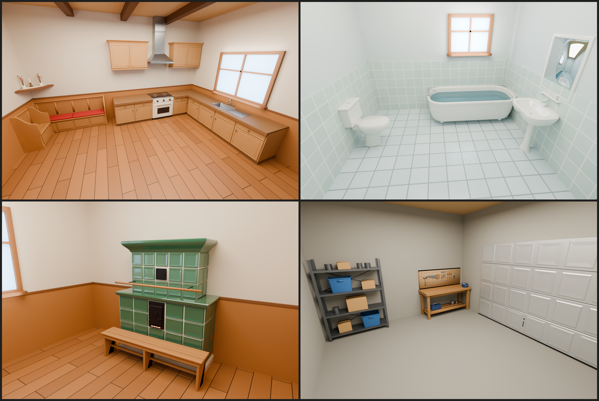

# Zařízení domu v Blenderu a ve hře



Hezčí modely všeho, co je v domě **pevně zabudované** a co se při stěhování neodnáší: kuchyňská linka, sporák,
linka s dřezem, horní skříňky, digestoř, rohová lavice se svatým koutkem, vana, záchod, umyvadlo se zrcadlem,
**kachlová kamna** v obýváku a v garáži ponk, regál a garážová vrata. Dnes je hra staví z kostiček
(`src/server/HouseInterior.luau`); s tímhle modelem (8.8.1) dostane každý dům (malý i velký) alpskou kuchyni,
koupelnu, kamna a garáž z Blenderu. Každý druh má **přesně rozměry ze hry**, takže se ve hře nic jiného nemění:
kolize, místa nábytku i chození zůstávají. Všechno postavil skript `fixtures.py`, takže každou barvu a tvar můžeš
změnit a nechat postavit znovu.

| Druh (`id`) | Rozměry š × v × h | Jak vypadá |
| --- | --- | --- |
| Kuchyňská linka (`counter`) | 4,5 × 3 × 2,6 | borovicová skříňka, dva šuplíky a dvoje dvířka s rámem a výplní, dřevěné knoflíky, dřevěná pracovní deska s lištou vpředu |
| Sporák (`stove`) | 3 × 3 × 2,6 | krémový smalt, černá varná deska v chromovém rámečku se dvěma hořáky, tři knoflíky, trouba s okénkem a madlem |
| Linka s dřezem (`sink`) | 9 × 3 × 2,6 | linka jako `counter`, uprostřed nerezový dřez zapuštěný do desky, odkapávač, baterie s labutím krkem a dva kohoutky |
| Horní skříňky (`cabinets`) | 4,5 × 3 × 1,4 | dvoje dvířka s výplní, římsa nahoře, lišta dole (visí od výšky 6,4) |
| Digestoř (`hood`) | 3 × 2,2 × 1,8 | nerezový kryt s mřížkou zespodu a komín až ke stropu (visí od výšky 7) |
| Rohová lavice (`corner_bench`) | 7 × 3,4 × 1,6 | prkenný sedák na truhle s výplněmi, opěradlo s rámem a výplněmi, tvarované bočnice, dva polštáře s knoflíky |
| Krátká lavice (`bench`) | 2,4 × 3,4 × 1,6 | druhé rameno rohové lavice, bez polštáře |
| Svatý koutek (`corner_shelf`) | 2,2 × 1,4 × 2,2 | trojúhelníková polička v rohu (visí od výšky 4,9), háčkovaná dečka, svíčka na soustruženém svícnu, dva džbánky se suchými květinami |
| Vana (`tub`) | 7,2 × 2,2 × 3,4 | bílá vana se zaobleným okrajem na čtyřech nožkách, voda, baterie na konci |
| Záchod (`toilet`) | 1,8 × 3,2 × 2,8 | mísa na noze, prkénko a sklopené víko, nádržka u zdi s tlačítkem |
| Umyvadlo (`basin`) | 2,6 × 3,2 × 1,8 | umyvadlo na noze s baterií, polička s kelímkem a zrcadlo v bílém rámu (do výšky 6,9) |
| Kachlová kamna (`kachelofen`) | 6 × 6,6 × 3,2 | kamenný sokl, spodní patro z vystouplých kachlí se spárami, římsa, světlejší horní patro, velká římsa nahoře; litinová dvířka se žhnoucím průduchem, dvířka pícky, tyč na sušení a dřevěná lavice vpředu |
| Ponk (`workbench`) | 6,4 × 3,2 × 2,4 | silná prkenná deska na čtyřech nohách, polička s kufříkem a plechovkami, děrovaná deska s nářadím (do výšky 5,5), svěrák |
| Regál (`shelves`) | 5 × 7 × 1,6 | kovový regál ze L-profilů se čtyřmi policemi a křížovými vzpěrami, dvě modré přepravky, krabice, plechovky |
| Garážová vrata (`garage_door`) | 12 × 8,5 × 0,3 | sekční vrata ze čtyř dílů s kazetami, madlo, zámek, gumové těsnění |

| Soubor | Co to je |
| --- | --- |
| `fixtures.blend` | Hotová scéna: 15 druhů v řadě a čtyři zařízené místnosti, světla, kamery. Stačí ji otevřít. |
| `fixtures.py` | Skript, který všechno postaví (je přibalený i uvnitř `fixtures.blend`). |
| `roblox/ZDCFixtureArt.fbx` | **Model pro hru**: každý druh rozdělený podle povrchu (krok 4). |
| `roblox/ZDCFixtureArt.json` | Seznam dílů a povrchů (podle něj kontrola `tools/fixtures-art/check.py` ověří, že všechno sedí). |
| `fixtures-preview.png` | Náhled z Blenderu (Cycles): kuchyně, koupelna, obývák s kamny, garáž. |
| `KONTRAKT.md` | Dohoda mezi Blenderem a hrou (rozměry, názvy dílů, co smí přečnívat). |

## 1. Otevři ho v Blenderu
Dvakrát klikni na `fixtures.blend` (nebo *File → Open*). Je uložený v Blenderu 5.2. Pokud ho tvoje verze neotevře,
otevři prázdný Blender a spusť `fixtures.py` (krok 3): postaví úplně stejnou scénu.

Ovládání v 3D okně:
- **prostřední tlačítko myši** = otáčení, **Shift + prostřední** = posun, **kolečko** = přiblížení;
- klikni na díl a zmáčkni **Numpad .** (tečka) = přiblíží se na něj, **Home** = ukáže všechno;
- **Numpad 1 / 3 / 7** = zepředu / z boku / shora, **Numpad 0** = pohled kamery;
- **Z** = způsob zobrazení (Material Preview ukazuje barvy, Rendered ukazuje světla);
- **F12** = render přes aktivní kameru. Každá místnost má svou kameru: v Outlineru klikni třeba na `Kamera Kuchyně`
  a zmáčkni **Ctrl + Numpad 0** (teď je aktivní ona), pak F12. Hezčí obrázek dá *Render Engine: Cycles*.

## 2. Prohlédni si, jak je postavený
Vpravo nahoře je **Outliner**:
- kolekce **Zařízení** má pro každý druh vlastní kolekci `Z_counter`, `Z_stove`, `Z_kachelofen` … (v řadě po 3
  studech mezery). Díly mají česká jména (`Korpus`, `Dvířka`, `Knoflík`, `Pracovní deska`, `Kachle`, `Římsa` …).
  Spodek druhu je na zemi, předek míří k tobě (na −Y, do místnosti), záda na +Y (ke zdi), 1 jednotka = 1 stud;
- kolekce **Náhled** jsou čtyři místnosti (`Kuchyně`, `Koupelna`, `Obývák`, `Garáž`) rozestavěné tak, jak je staví
  hra (`shared/HouseLayout.luau`): podlaha, zdi s obložením, okna, světla, kamera a kopie druhů z řady. Kopie
  sdílí tvar i materiály s řadou: když v řadě upravíš tvar sporáku (Edit Mode), změní se i v kuchyni.

Na čem se dá učit:
1. Klikni na díl (třeba pracovní desku) a otevři panel **Modifiers** (ikona klíče). **Bevel** zakulacuje hrany: zkus
   změnit *Amount* nebo *Segments*.
2. Zmáčkni **Tab**. Jsi v režimu úprav (Edit Mode), kde **G / R / S** posouvá, otáčí a zvětšuje vybrané body.
   **Tab** tě vrátí zpátky.
3. Barvu změníš v panelu **Material** (červená koule), položka *Base Color*. Materiály se jmenují podle povrchu
   (`F cabinet`, `F tile`, `F enamel` …) a sdílí je všechny druhy: změna `F cabinet` přebarví všechny skříňky.

## 3. Změň ho skriptem a postav znovu
Nahoře klikni na záložku **Scripting**, v textovém editoru vyber `fixtures.py` (nebo *Open* a soubor `fixtures.py`).
Nahoře je **NASTAVENÍ**, pod ním seznam druhů a povrchů:

```python
EXPORT = False   # True = uloží ZDCFixtureArt.fbx pro hru do složky "roblox"
FINISHES = {
    "cabinet": ("#C69864", 0.6, 0, 0, "Wood"),   # barva, drsnost, kov, záře, materiál v Robloxu
    "tile": ("#406E54", 0.18, 0, 0, "SmoothPlastic"),
    ...
```

Každý druh má vlastní funkci (`def counter`, `def stove`, `def kachelofen` …), kde jsou jeho díly: `box` (kvádr se
zaoblenými hranami), `chamfer` (kvádr se sraženými hranami), `cyl` (válec), `ball` (koule), `tube` (trubka),
`lathe` (soustružený tvar: knoflík, svícen, džbánek, noha umyvadla), `sweep` (trubka po křivce: baterie, stonky),
`prism` (plochý tvar vytažený do hloubky: bočnice lavice, podnož), `plate` (deska tvaru při pohledu shora: svatý
koutek), `loft` (skořepina přes obrysy: vana, umyvadlo, mísa záchodu, digestoř, římsy), `tiles` (vystouplé kachle se
spárami a kazety vrat) a `front_panel` (dvířka a šuplíky s rámem a výplní). Změň, co chceš, a zmáčkni **Run Script**
(▶ nebo Alt + P). Stará scéna se smaže a postaví se nová. Když druh vyleze ze své krabice, skript to vypíše
(*sticks out*).

Barvy čtyř povrchů mění hra podle domu (stejně jako dnes): `tile` (kachle kamen), `tile2` (jejich horní patro),
`pine` (borovice lavic a lavice u kamen) a `cushion` (polštáře). Barva v `FINISHES` je u nich jen ukázka pro Blender.
Ostatní povrchy mají ve hře přesně barvu a materiál z `FINISHES`.

Rozměry v seznamu `KINDS` neměň: hra má stejné a kontrola hlídá, že sedí. Nahoru ze své krabice smí jen to, co
přečnívá i dnes (`REACH`): komín digestoře až ke stropu, zrcadlo nad umyvadlem, děrovaná deska nad ponkem (a svěrák na
něm) a baterie u dřezu a u vany. Dopředu do místnosti ani dozadu do zdi nesmí nic. Kdybys chtěl něco většího i ve hře,
řekni Claudovi.

## 4. Zařízení ve hře
Hra tyhle modely použije v každém domě: oblékne do nich kuchyň, koupelnu, kachlová kamna v obýváku a garáž
(`src/server/FixtureMesh.luau`). Pevné kostičky, do kterých se naráží (skříňky, sporák, vana, kamna, ponk …),
zůstanou neviditelné na svém místě, takže kolize i chození zůstávají; ostatní kostičky zmizí a místo nich je model
z Blenderu. Barva kachlí, borovice lavic a polštáře se mění podle domu, takže dvě kuchyně nejsou stejné.

Nový vzhled se objeví, až model jednou nahraješ do Roblox Studia. Udělat to musíš ty: Roblox zobrazí 3D model jen
tehdy, když je nahraný pod tvým účtem, a k tvému účtu se nepřihlásím. Do té doby mají domy dosavadní vzhled z dílů
(nic se nerozbije).

Jednou ve Studiu (s hrou otevřenou jako obvykle):
1. Pokud už tam starší `ZDCFixtureArt` je (ve Workspace nebo v ServerStorage), klikni na něj v Exploreru a dej
   **Delete**. Starý model musí pryč dřív, než přidáš nový: kdyby zůstaly oba, hra by si mohla vzít ten starý.
2. *File → Import 3D* (nebo karta *Home → Import 3D*) a vyber `design/blender-fixtures/roblox/ZDCFixtureArt.fbx`.
   Nastavení nech, jak je, a dej **Insert / Import**. Ve Workspace se objeví model `ZDCFixtureArt` (řada zařízení).
3. Přetáhni ho v Exploreru do **ServerStorage**. Hra by si ho schovala i sama, ale takhle je to jistota.
4. Ulož místo (*File → Save*) a *File → Publish to Roblox*, ať ho má i hra na Robloxu.

Vyzkoušení: dej **Play**, zmáčkni **P** (admin panel) a jdi do domu jako při stěhování (záložka **Moves**: **▶ MOVE:
START NOW** a **MOVE: GO TO THE HOUSE**, nebo v SANDBOXu **🏠 REFILL HOUSE** a **📍 TO HOUSE**). V kuchyni, koupelně,
obýváku a garáži uvidíš nové zařízení.

Když zařízení v Blenderu změníš: nastav `EXPORT = True`, ulož `.blend` (Ctrl + S) a spusť skript. Pak ve Studiu smaž
starý `ZDCFixtureArt` a naimportuj nový `roblox/ZDCFixtureArt.fbx` (stejně jako výše).

### Jak to funguje (pro zvědavé)
- Každý druh je rozdělený podle povrchu: díl `counter_cabinet` je všechno borovicové dřevo linky, `counter_worktop`
  její deska a knoflíky, `kachelofen_tile` spodní kachle a římsy kamen. Hra dá každému dílu barvu a materiál Robloxu
  (dřevo = Wood, smalt a kachle = SmoothPlastic s leskem, nerez = Metal, voda = Glass, žár v kamnech = Neon …).
  38 dílů má dohromady asi 20 tisíc trojúhelníků (nejvíc kamna, asi 2 500), takže hru nezpomalí.
- Malé kostičky `mark_o`, `mark_x`, `mark_y`, `mark_z` ukazují hře, jak Roblox model při importu otočil a zvětšil,
  `mark_counter`, `mark_stove` … kde má který druh svůj počátek (střed spodku krabice) a `mark_counter_box` … roh jeho
  krabice. Proto na nastavení importu nezáleží.
- Žár v kamnech je jediný svítící (Neon) díl a je malý (proužek 0,6 × 0,1 studu v průduchu dvířek).

## Bez Blenderu (pro AI pomocníky)
`pip install bpy` (Python 3.13) a z této složky:
```
python fixtures.py -- --save fixtures.blend --export roblox --render /tmp/fixtures-renders --samples 96
```
Render udělá `room-1.png` … `room-4.png` (kuchyně, koupelna, obývák, garáž) a z nich složený `fixtures-preview.png`
(zkopíruj ho sem). Jen některé druhy po jednom, bez místností: `--only counter,kachelofen` (`item-<druh>.png`). Po
změně modelu spusť z kořene repozitáře `python3 zombie-delivery/tools/fixtures-art/check.py <luau>` (simuluje import
do hry a ověří, že každý díl sedí ve své krabici, nic nekoliduje a domy zůstanou v rozpočtu dílů).
