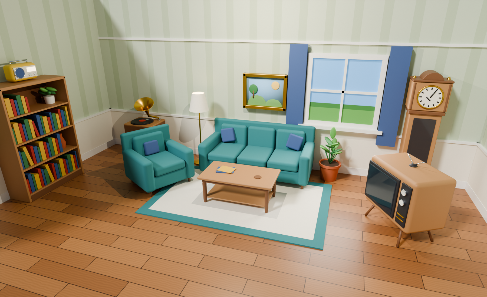
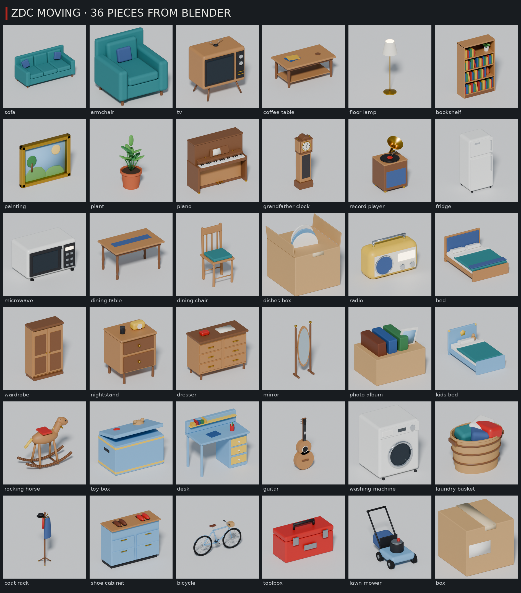
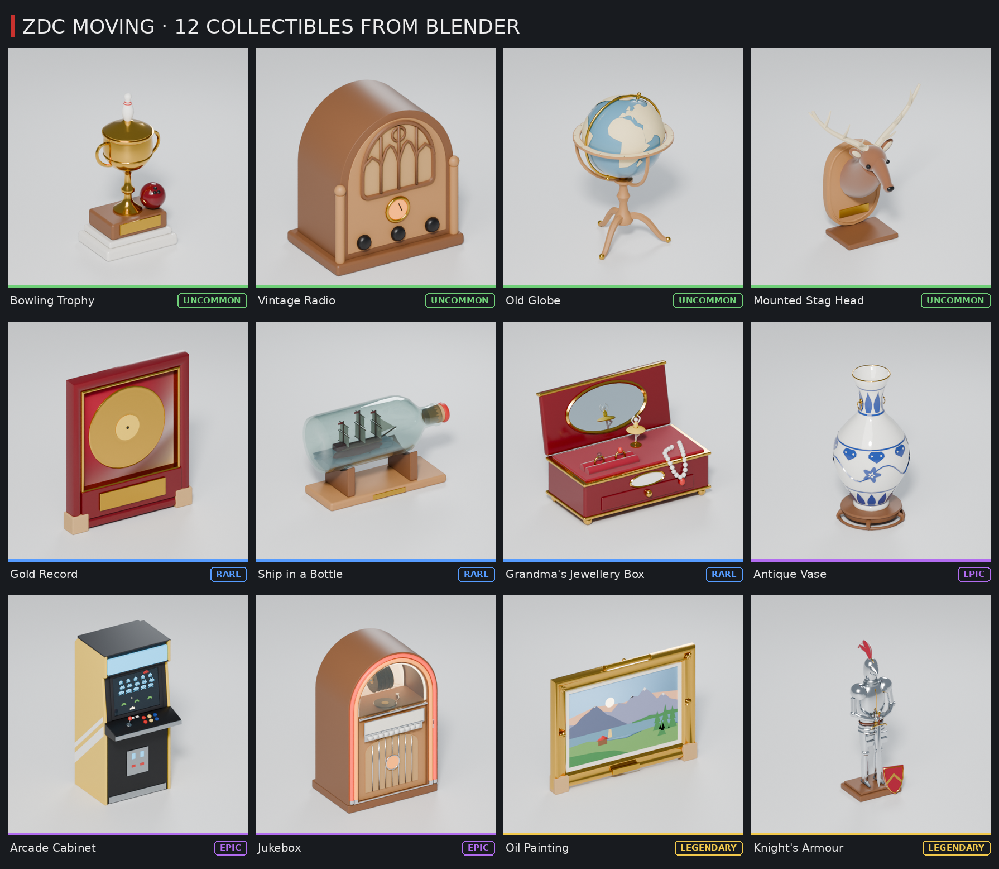
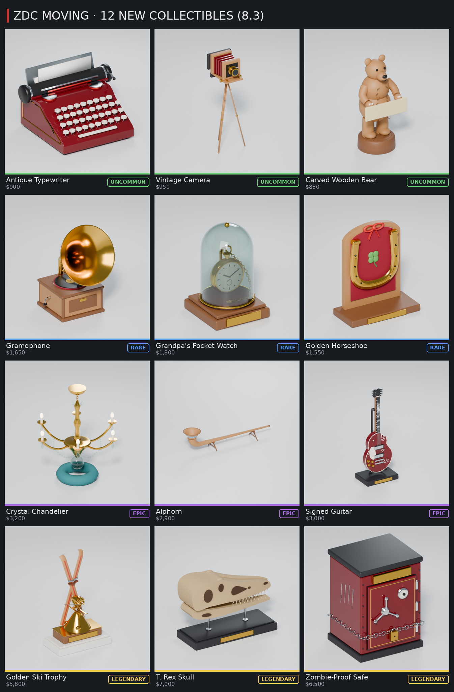

# Nábytek pro stěhování v Blenderu a ve hře



Hezčí modely všech **36 věcí, které se ve stěhování (7.0 MOVES) odnášejí z domu**: od gauče, piana a ledničky po
houpacího koně, kolo a krabici s nádobím. K nim (8.1) **12 sběratelských kousků z 8.0 SANDBOXu**: vzácné věci, které
se objevují v domě vedle nábytku a které pak vystavíš ve skladu (trofej, rádio, glóbus, jelení hlava, zlatá deska, loď
v láhvi, babiččina šperkovnice, váza, herní automat, jukebox, olejomalba a rytířská zbroj) a (8.3) **dalších 12**:
psací stroj, fotoaparát na stativu, vyřezávaný medvěd, gramofon, dědovy kapesní hodinky, zlatá podkova, křišťálový lustr,
alpský roh, podepsaná kytara, zlatá lyžařská trofej, lebka T. rexe a sejf odolný proti zombiím. Každý kus má **přesně
rozměry ze hry** (neviditelná krabice `Root`, kterou hráči nosí a skládají do auta), takže se ve hře nic nezmění, jen
vzhled. Vedle katalogu je zařízený **obývák** (obrázek nahoře). Všechno postavil skript `furniture.py`, takže každou
barvu a tvar můžeš změnit a nechat postavit znovu.







Sběratelské kousky jsou to nejvzácnější, co v domě najdeš, tak mají víc detailů: zlato se leskne (povrch `gilt`), sklo
láhve a jukeboxu je čiré (`crystal`), trubice jukeboxu, ciferník rádia a reklama automatu svítí (`amber`, `ember`,
`neon`), váza je bílý porcelán s modrým (kobaltovým) malováním, glóbus má pevniny na starém modrém moři. Každý má
1 až 5 tisíc trojúhelníků (rytířská zbroj, největší, asi 6 500), takže hru nezpomalí. Dvanáct nových z 8.3 má 3 až 6 tisíc
trojúhelníků; lebka T. rexe má nový povrch `fossil` (zkamenělá kost), její otvory jsou tmavá hlína (`soil`).

| Soubor | Co to je |
| --- | --- |
| `furniture.blend` | Hotová scéna: 60 kusů v mřížce (36 kusů nábytku a 24 sběratelských), obývák, světla, kamera. Stačí ji otevřít. |
| `furniture.py` | Skript, který všechno postaví (je přibalený i uvnitř `furniture.blend`). |
| `roblox/ZDCFurnitureArt.fbx` | **Model pro hru**: každý kus rozdělený podle povrchu (krok 4). |
| `roblox/ZDCFurnitureArt.json` | Seznam dílů (podle něj kontrola `mesh-check.py` ověří, že nábytek ve hře sedí). |
| `furniture-preview.png`, `collectibles-preview.png`, `collectibles-83-preview.png`, `room-preview.png` | Náhledy z Blenderu (Cycles). |

## 1. Otevři ho v Blenderu
Dvakrát klikni na `furniture.blend` (nebo *File → Open*). Je uložený v Blenderu 5.2. Pokud ho tvoje verze neotevře,
otevři prázdný Blender a spusť `furniture.py` (krok 3): postaví úplně stejnou scénu.

Ovládání v 3D okně:
- **prostřední tlačítko myši** = otáčení, **Shift + prostřední** = posun, **kolečko** = přiblížení;
- klikni na kus a zmáčkni **Numpad .** (tečka) = přiblíží se na něj, **Home** = ukáže všechno;
- **Numpad 1 / 3 / 7** = zepředu / z boku / shora, **Numpad 0** = pohled kamery (celý katalog);
- **Z** = způsob zobrazení (Material Preview ukazuje barvy, Rendered ukazuje světla);
- **F12** = render přes aktivní kameru. Obývák má vlastní kameru: v Outlineru klikni na `Room camera` a zmáčkni
  **Ctrl + Numpad 0** (teď je aktivní ona), pak F12. Hezčí obrázek dá *Render Engine: Cycles* v panelu Render.

## 2. Prohlédni si, jak je postavený
Vpravo nahoře je **Outliner**:
- kolekce **Furniture** má pro každý kus vlastní kolekci `F_sofa`, `F_piano`, `F_fridge` … (60 kusů v řadách po 6,
  10 studů od sebe; sběratelské kousky `F_bowling_trophy` … `F_zombie_safe` jsou poslední čtyři řady). Spodek kusu
  je na zemi, předek míří k tobě (na −Y), 1 jednotka v Blenderu = 1 stud ve hře;
- kolekce **Room** je obývák: podlaha z prken, tapeta, lišty, okno se záclonami, koberec, světla, kamera a kopie
  kusů z katalogu. Kopie sdílí tvar i materiály s katalogem: když v katalogu upravíš tvar gauče (Edit Mode),
  změní se i v obýváku.

Na čem se dá učit:
1. Klikni na díl (třeba polštář gauče) a otevři panel **Modifiers** (ikona klíče). **Bevel** zakulacuje hrany: zkus
   změnit *Amount* nebo *Segments*.
2. Zmáčkni **Tab**. Jsi v režimu úprav (Edit Mode), kde **G / R / S** posouvá, otáčí a zvětšuje vybrané body.
   **Tab** tě vrátí zpátky.
3. Barvu změníš v panelu **Material** (červená koule), položka *Base Color*. Materiály se jmenují podle povrchu
   (`F wood`, `F fabric`, `F brass` …) a sdílí je všechny kusy: změna `F wood` přebarví všechno dřevo.

## 3. Změň ho skriptem a postav znovu
Nahoře klikni na záložku **Scripting**, v textovém editoru vyber `furniture.py` (nebo *Open* a soubor `furniture.py`).
Nahoře je **NASTAVENÍ** a pod ním seznam povrchů:

```python
EXPORT = False   # True = uloží ZDCFurnitureArt.fbx pro hru do složky "roblox"
FINISHES = {
    "fabric": ("#367C80", 0.9, 0, 0),   # barva, drsnost, kov, záře
    "wood": ("#B08052", 0.55, 0, 0),
    ...
```

Každý kus má vlastní funkci (`def sofa`, `def piano`, `def jukebox` …), kde jsou jeho díly: `box` (kvádr se
zaoblenými hranami), `cyl` (válec), `ball` (koule), `tube` (trubka), `lathe` (soustružený tvar jako váza nebo noha
lampy) a `torus` (prstenec); sběratelské kousky navíc `sweep` (trubka po křivce: paroží, ucha poháru, bublinkové
trubice jukeboxu), `prism` (plochý tvar vytažený do hloubky: oblouk rádia, štít, bok automatu), `rect_frame` (lišta
rámu obrazu) a `sprite` (pixelová grafika na obrazovce automatu). Změň, co chceš, a zmáčkni **Run Script** (▶ nebo
Alt + P). Stará scéna se smaže a postaví se nová. Když kus vyleze ze své krabice, skript to vypíše (*sticks out*).

Pozor u kousků s nápisem (trofej, jelení hlava, zlatá deska, automat, jukebox, olejomalba; 8.3: psací stroj, medvěd,
hodinky, podkova, kytara, lyžařská trofej, lebka T. rexe a sejf): nápis tiskne hra na
štítek a pod ním musí zůstat díl modelu (mosazná destička, krémový pruh, svítící reklama) a před ním nic. Kontrola
`mesh-check.py` to hlídá.

Rozměry kusů v seznamu `ITEMS` neměň: hra má stejné rozměry v `src/shared/FurnitureLooks.luau` a kontrola hlídá,
že sedí. Kdybys chtěl kus větší nebo menší i ve hře, řekni Claudovi.

## 4. Nábytek ve hře
Hra tyhle modely použije v každém domě při stěhování (Marge's House, v SANDBOXu The Old Chalet) a sběratelské kousky
i na stojanech ve skladu. Hráči nosí pořád stejnou krabici `Root` (kolize, nošení, nakládání do auta i poškození
zůstávají), jen místo kostiček z dílů uvidí model z Blenderu. Barvy látek, dřeva a laku (a u sběratelských kousků
zlata, sametu, laku, neonu a srsti) se mění podle varianty kusu, takže dva gauče v různých domech nejsou stejné. Nápisy
na krabicích (FRAGILE · KITCHEN, TOYS, FAMILY PHOTOS, THIS SIDE UP) i na sběratelských kouscích (LEAGUE CHAMPION,
1,000,000 SOLD, HIT PARADE, název hry na automatu …) zůstávají.

Nový vzhled se objeví, až model jednou nahraješ do Roblox Studia. Udělat to musíš ty: Roblox zobrazí 3D model jen
tehdy, když je nahraný pod tvým účtem, a k tvému účtu se nepřihlásím. Do té doby má nábytek dosavadní vzhled z dílů.

Jednou ve Studiu (s hrou otevřenou jako obvykle):
1. *File → Import 3D* (nebo karta *Home → Import 3D*) a vyber `design/blender-furniture/roblox/ZDCFurnitureArt.fbx`.
2. Nastavení nech, jak je, a dej **Insert / Import**. Ve Workspace se objeví model `ZDCFurnitureArt` (velká mřížka
   nábytku). Může zůstat, kde je: hra ho při spuštění sama schová a oblékne z něj každý kus v domě.
3. Ulož místo (*File → Save*) a *File → Publish to Roblox*, ať ho má i hra na Robloxu.

Vyzkoušení: dej **Play**, zmáčkni **P** (admin panel), v sekci **Moves** dej **▶ MOVE: START NOW** a pak **MOVE: GO
TO THE HOUSE**. Dveře domu jsou zamčené: vykopni je (*Kick door*, Technician je odemkne: *Pick lock*) a dej
*Enter house*. Uvnitř uvidíš nový nábytek.

### 8.1: sběratelské kousky, nový model (naimportuj ho znovu)
V `roblox/ZDCFurnitureArt.fbx` je teď i 12 sběratelských kousků. Ve Studiu je proto **jednou naimportuj znovu**:
1. V Exploreru najdi starý `ZDCFurnitureArt` (ve Workspace, nebo v ServerStorage, pokud jsi ho tam přesunul),
   klikni na něj a dej **Delete**. Starý model musí pryč dřív, než přidáš nový: kdyby zůstaly oba, hra by si mohla
   vzít ten starý (bez sběratelských kousků).
2. *File → Import 3D* a vyber nový `design/blender-furniture/roblox/ZDCFurnitureArt.fbx` (po `git pull` je to ten
   nový). Nastavení nech, jak je, a dej **Insert / Import**.
3. Ulož místo (*File → Save*) a *File → Publish to Roblox*.

Vyzkoušení v SANDBOXu: dej **Play**, zmáčkni **P** (admin panel, záložka **SANDBOX**) a dej **🏠 REFILL HOUSE**
a **📍 TO HOUSE**: v chalupě jsou 2 až 4 sběratelské kousky (každý tah znovu jiné). Nebo **📦 FILL STOCK**,
**⭐ FILL STANDS** a **📍 TO WAREHOUSE**: kousky z Blenderu stojí na stojanech ve skladu. Dokud nový model
nenaimportuješ, mají sběratelské kousky dosavadní vzhled z dílů (nic se nerozbije).

Když nábytek v Blenderu změníš: nastav `EXPORT = True`, ulož `.blend` (Ctrl + S) a spusť skript. Pak ve Studiu smaž
starý `ZDCFurnitureArt` a naimportuj nový `roblox/ZDCFurnitureArt.fbx` (stejně jako výše).

### 8.3: dalších 12 sběratelských kousků, nový model (naimportujte ho znovu)
V `roblox/ZDCFurnitureArt.fbx` je teď 24 sběratelských kousků. Ve Studiu ho proto **jednou naimportujte znovu**, stejně
jako v 8.1:
1. V Exploreru najděte starý `ZDCFurnitureArt` (ve Workspace, nebo v ServerStorage), klikněte na něj a dejte **Delete**.
2. *File → Import 3D* a vyberte nový `design/blender-furniture/roblox/ZDCFurnitureArt.fbx` (po `git pull`). Nastavení
   nechte, jak je, a dejte **Insert / Import**.
3. Uložte místo (*File → Save*) a *File → Publish to Roblox*.

Dokud to neuděláte, mají nové kousky vzhled z dílů (nic se nerozbije). Vyzkoušení: **Play**, **P** (záložka
**SANDBOX**), **🏠 REFILL HOUSE** a **📍 TO HOUSE** (v chalupě jsou pořád 2 až 4 sběratelské kousky, jen z větší
nabídky), nebo **📦 FILL STOCK**, **⭐ FILL STANDS** a **📍 TO WAREHOUSE**. Sbírka (klávesa C) má teď 68 kusů.

### Jak to funguje (pro zvědavé)
- Každý kus je rozdělený podle povrchu: díl `sofa_fabric` je všechna látka gauče, `sofa_wood2` jeho nohy. Hra
  (`src/server/FurnitureMesh.luau`) dá každému dílu barvu a materiál Robloxu (látka = Fabric, dřevo = Wood, mosaz
  = Metal, sklo = Glass, svítící trubice = Neon …). 380 dílů má dohromady asi 187 000 trojúhelníků (z toho 24
  sběratelských kousků asi 102 000).
- Malé kostičky `mark_o`, `mark_x`, `mark_y`, `mark_z` ukazují hře, jak Roblox model při importu otočil a zvětšil,
  a `mark_sofa`, `mark_piano` … kde stojí který kus. Proto na nastavení importu nezáleží.
- Dům staví `src/server/HouseInterior.luau`: každý kus postaví jako dřív a hned ho oblékne do modelu z Blenderu.
  Kus z modelu má méně dílů než ten původní, takže je dům i lehčí.

## Bez Blenderu (pro AI pomocníky)
`pip install bpy` (Python 3.13) a z této složky:
```
python furniture.py -- --save furniture.blend --export roblox --render /tmp/furniture-renders --samples 64
```
Render udělá `item-NN-<id>.png` pro každý kus a `room.png` (obývák). Náhled `furniture-preview.png` je z nich složený
arch. Jen sběratelské kousky: `--render /tmp/collectibles --samples 64 --only collectibles` (12 obrázků
`item-36-bowling_trophy.png` … `item-47-knight_armour.png`, z nich je složený `collectibles-preview.png`, 4 × 3
s vzácností každého kousku). Jen dvanáct nových z 8.3: `--only new83` (`item-48-antique_typewriter.png` …
`item-59-zombie_safe.png`, z nich je složený `collectibles-83-preview.png`, řádek po vzácnosti). Po změně modelu spusť z kořene repozitáře `python3 zombie-delivery/tools/furniture/mesh-check.py <luau>`
(simuluje import do hry a ověří, že každý díl sedí ve své krabici, je přivařený k Root a nic nekoliduje).
