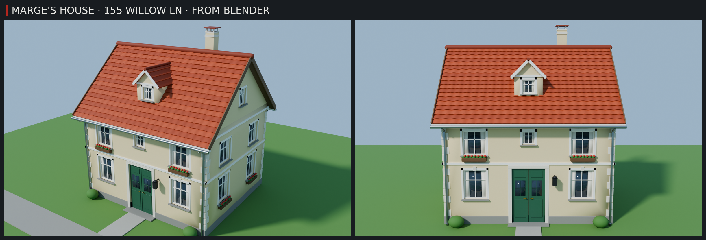

# Dům Marge v Blenderu a ve hře



Dům na adrese **155 Willow Ln**, ze kterého se stěhuje v prvním stěhování (Marge's House), jako **klasický evropský
rodinný dům**:
- krémová omítka, šedý sokl, světlé rohové kvádry a bílé římsy mezi patry a pod střechou;
- okna s bílým křížem, šambránami, kamennými parapety a záclonkami, v patře a na bocích truhlíky s červenými
  muškáty;
- dvoukřídlé zelené dveře v kamenném portálu se schodem a lucernou, která v noci svítí;
- strmá sedlová střecha z pálených tašek (esovky) s vikýřem, hřebenáči a komínem, okapy a svody, dva keře u vchodu.

Dům má **přesně rozměry domu ve hře** (20,4 × 12,6 × 17,6 studu, střecha je vyšší). Kolize, dveře i cesta k autu
zůstávají stejné, mění se jen vzhled. Na přední zdi hra při stěhování věší transparent MOVING DAY a staví krabice,
srolovaný koberec a cedule. Okna, truhlíky i lucerna jsou proto rozmístěné tak, aby se s nimi nepotkaly.

| Soubor | Co to je |
| --- | --- |
| `house.blend` | Hotová scéna: dům, trávník, cesta, slunce a dvě kamery. Stačí ji otevřít. |
| `house.py` | Skript, který dům postaví (je přibalený i uvnitř `house.blend`). |
| `roblox/ZDCHouseArt.fbx` | **Model pro hru**: dům rozdělený podle povrchu (krok 4). |
| `roblox/ZDCHouseArt.json` | Seznam dílů (podle něj kontrola `check.py` ověří, že dům ve hře sedí). |
| `house-preview.png` | Náhled z Blenderu (Cycles): ze strany a z ulice. |

## 1. Otevři ho v Blenderu
Dvakrát klikni na `house.blend` (nebo *File → Open*). Je uložený v Blenderu 5.2. Pokud ho tvoje verze neotevře,
otevři prázdný Blender a spusť `house.py` (krok 3): postaví úplně stejný dům.

Ovládání v 3D okně:
- **prostřední tlačítko myši** = otáčení, **Shift + prostřední** = posun, **kolečko** = přiblížení;
- **Home** = ukáže celý dům, **Numpad 1 / 3 / 7** = zepředu / z boku / shora;
- **Numpad 0** = pohled kamery `Kamera` (dům ze strany). Druhá kamera `Kamera ulice` ukazuje dům z ulice: klikni na
  ni v Outlineru a zmáčkni **Ctrl + Numpad 0**;
- **Z** = způsob zobrazení (Material Preview ukazuje barvy, Rendered světla);
- **F12** = render přes aktivní kameru. Hezčí obrázek dá *Render Engine: Cycles* v panelu Render.

## 2. Prohlédni si, jak je postavený
V Outlineru je kolekce **House** a v ní všechny díly s českými jmény: `Zdi`, `Sokl`, `Štíty`, `Okno rám`,
`Okno šambrána`, `Tašky`, `Hřebenáč`, `Vikýř`, `Komín`, `Svod` …

Okna a dveře jsou do zdí **vyříznuté**: schovaná kolekce **House cutters** obsahuje kvádry, které modifikátor
**Boolean** odečte ze zdí, soklu, štítů a vikýře.

Na čem se dá učit:
1. Klikni na `Zdi` a otevři panel **Modifiers** (ikona klíče). Vypni Boolean ikonou monitoru a okna zmizí.
2. V Outlineru zapni oko u **House cutters**, klikni na jeden řez okna, zmáčkni **G** a posuň ho. Otvor v omítce se
   posune s ním (rám a sklo ne, ty jsou samostatné díly).
3. Klikni na díl a zmáčkni **Tab**. Jsi v režimu úprav (Edit Mode), kde **G / R / S** posouvá, otáčí a zvětšuje
   vybrané body. **Tab** tě vrátí zpátky.
4. Barvu změníš v panelu **Material** (červená koule), položka *Base Color*. Materiály se jmenují podle povrchu
   (`H plaster` = omítka, `H tile` = tašky, `H door` = dveře …) a změna přebarví všechno s tím povrchem.

## 3. Změň ho skriptem a postav znovu
Nahoře klikni na záložku **Scripting** a v textovém editoru vyber `house.py` (nebo *Open* a soubor `house.py`). Nahoře
je **NASTAVENÍ**:

```python
EXPORT = False   # True = uloží ZDCHouseArt.fbx pro hru do složky "roblox"
W, H, D = 20.3572, 12.5980, 17.5669   # rozměry domu ve hře: neměň
PITCH = 42        # sklon střechy (stupně)
FINISHES = {
    "plaster": ("#E8D3A2", 0.85, 0, 0),   # omítka: barva, drsnost, kov, záře
    "tile": ("#B5502E", 0.7, 0, 0),       # tašky
    "door": ("#2F5E45", 0.5, 0, 0),       # dveře
    ...
```

Změň, co chceš, třeba omítku na bílou `"#F2F0EA"` nebo dveře na modré `"#2E4A78"`, a zmáčkni **Run Script** (▶ nebo
Alt + P). Starý dům se smaže a postaví se nový. Každá část domu má v skriptu svou funkci: `walls` (zdi, rohy, římsy),
`fronts` (okna a dveře na každé straně), `window` (jedno okno), `door`, `roof` (střecha), `dormer` (vikýř),
`chimney` (komín).

Pozor na dvě věci:
- `W, H, D` neměň, jsou to rozměry domu ve hře. Kontrola ve hře by dům odmítla a zůstal by starý.
- **Barvy ve hře** nastavuje tabulka `LOOKS` v `src/server/HouseMesh.luau`, ne Blender, protože Roblox si barvy ze
  souboru nebere. Když změníš barvu v Blenderu a chceš ji i ve hře, řekni Claudovi.

## 4. Dům ve hře
Dům Marge na adrese 155 Willow Ln (nejbližší dům u depa v Suburbs) dostane vzhled z Blenderu, až model jednou nahraješ
do Roblox Studia. Udělat to musíš ty: Roblox zobrazí 3D model jen tehdy, když je nahraný pod tvým účtem, a k tvému
účtu se nepřihlásím. Do té doby má dům starý vzhled z kostiček.

Jednou ve Studiu (s hrou otevřenou jako obvykle):
1. *File → Import 3D* (nebo karta *Home → Import 3D*) a vyber `design/blender-house/roblox/ZDCHouseArt.fbx`.
2. Nastavení nech, jak je, a dej **Insert / Import**. Ve Workspace se objeví model `ZDCHouseArt`. Může zůstat, kde
   je (hra si ho při spuštění schová), nebo ho v Exploreru přetáhni do **ServerStorage**.
3. Ulož místo (*File → Save*) a *File → Publish to Roblox*, ať ho má i hra na Robloxu.

Vyzkoušení: dej **Play**, zmáčkni **P** (admin panel) → záložka **EVENTS** → sjeď dolů na **Moves** → **MOVE: GO
TO THE HOUSE**. Hra tě přenese přede dveře domu Marge.

Když dům v Blenderu změníš: nastav `EXPORT = True`, ulož `.blend` (Ctrl + S) a spusť skript. Pak ve Studiu smaž starý
`ZDCHouseArt` a naimportuj nový `roblox/ZDCHouseArt.fbx` (krok 1 až 3).

### Jak to funguje (pro zvědavé)
- Dům je rozdělený podle povrchu: díl `house_plaster` je všechna omítka, `house_tile` a `house_tile2` tašky (každá
  druhá řada je o kousek tmavší) a tak dál. Hra (`src/server/HouseMesh.luau`) dá každému dílu barvu a materiál.
  Dvacet dílů má dohromady asi 46 000 trojúhelníků.
- Malé kostičky `mark_o`, `mark_x`, `mark_y`, `mark_z` ukazují hře, jak Roblox model při importu otočil a zvětšil,
  `mark_box` velikost domu, pro který je model udělaný. Proto na nastavení importu nezáleží.
- Původní dům z kostiček (`src/server/World.luau`) ve hře zůstává, jen je neviditelný. Pořád do něj narážíš, takže
  kolize jsou stejné jako dřív. Zdi modelu stojí přesně na jeho stěnách a střecha ho celý přikryje.
- Vzhled z Blenderu má zatím jen dům Marge (`HouseMesh.Homes`). Ostatní domy v Suburbs mají jiné rozměry. Kdybys chtěl
  takhle i další domy, řekni Claudovi.

## Bez Blenderu (pro AI pomocníky)
`pip install bpy` (Python 3.13) a z této složky:
```
python house.py -- --save house.blend --export roblox --render /tmp/house-renders --samples 96
```
Render udělá `house-34.png` (ze strany) a `house-front.png` (z ulice), náhled `house-preview.png` je z nich složený.
Po změně modelu spusť z kořene repozitáře `python3 zombie-delivery/tools/house-art/check.py <luau>` (simuluje import do
hry na domě postaveném jako ve `World.luau` a ověří, že díly sedí, zdi stojí na kolizích a nic nepřekáží věcem ze
stěhování).
