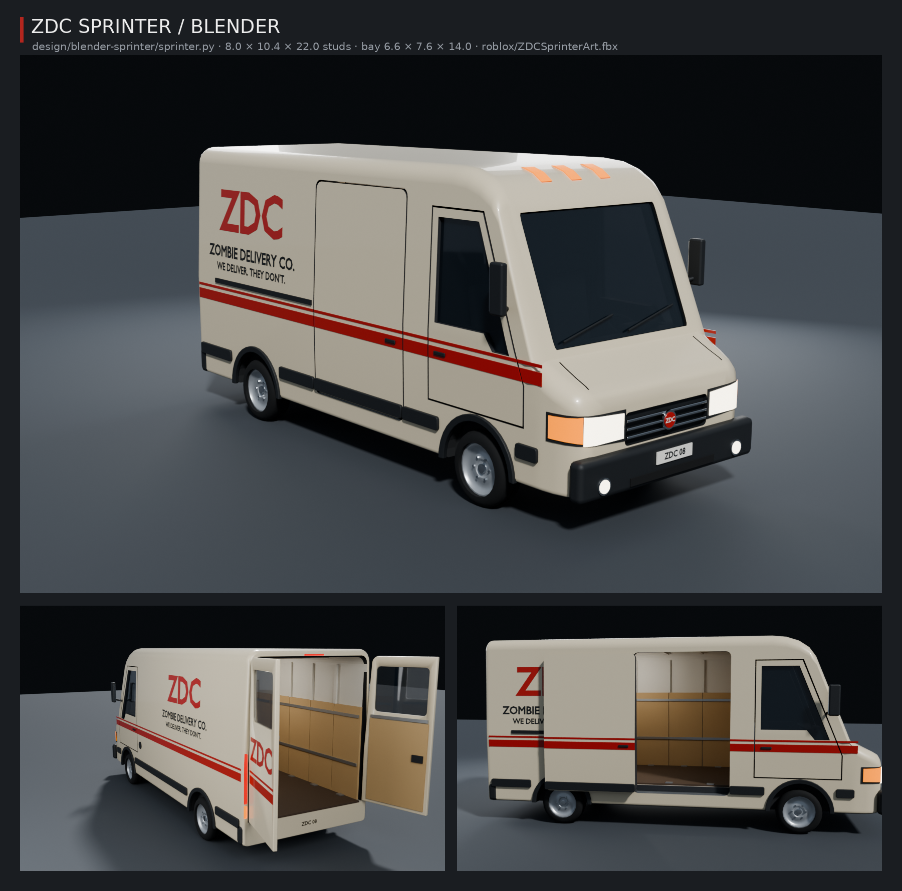

# ZDC Sprinter v Blenderu a ve hře



Tvůj model velké dodávky pro testovací verzi hry (8.0 SANDBOX): **ZDC Sprinter** s vysokou střechou, do kterého se dá
vejít. Má přesně rozměry Sprinteru ve hře: 8,0 × 10,4 × 22,0 studu (šířka bez zrcátek × výška × délka), rozvor 13,0,
světlá výška 1,2. Nákladový prostor uvnitř je 6,6 široký, 7,6 vysoký a 14,0 dlouhý, s podlahou 2,4 nad zemí; kabina je
předních 7 studů. Postavil ho skript `sprinter.py`, takže každou barvu a nápis můžeš změnit a nechat ho postavit znovu.

| Soubor | Co to je |
| --- | --- |
| `sprinter.blend` | Hotová scéna: dodávka, světla, kamera. Stačí ji otevřít. |
| `sprinter.py` | Skript, který dodávku postaví (je přibalený i uvnitř `sprinter.blend`). |
| `roblox/ZDCSprinterArt.fbx` | **Model pro hru**: karoserie s kabinou a nákladovým prostorem, dvoje dveře kabiny, posuvné dveře, dvě zadní křídla a kolo, každé zvlášť (krok 3). |
| `roblox/ZDCSprinterArt.json` | Seznam dílů, značek a změřených rozměrů (podle něj kontrola `mesh-check.py` ověří, že model ve hře sedí). |
| `sprinter-preview.png` | Náhled z Blenderu (Cycles): zepředu, zezadu s otevřenými dveřmi, z boku s odsunutými dveřmi. |

## 1. Otevři ho v Blenderu
Dvakrát klikni na `sprinter.blend`. Je uložený v Blenderu 5.2; když ho tvoje verze neotevře, otevři prázdný Blender
a spusť `sprinter.py` (záložka **Scripting** → *Open* → **Run Script**). Ovládání je stejné jako u ZDC Vanu
(`design/blender-van/NAVOD.md`): prostřední tlačítko myši otáčí, kolečko přibližuje, **Home** ukáže celou dodávku,
**F12** vyrenderuje obrázek.

V Outlineru (vpravo nahoře) jsou kolekce:
- **Sprinter_Body**: karoserie `Body` a všechno na ní i uvnitř (nárazníky, světla, nápisy, kabina se sedadly a volantem,
  nákladový prostor s překližkou, lištami na upínání a stropními světly);
- **Sprinter_CabDoorL** / **Sprinter_CabDoorR**: dveře kabiny (L = řidič, vlevo), **Sprinter_SideDoor**: posuvné dveře
  vpravo, **Sprinter_BackDoorL** / **Sprinter_BackDoorR**: zadní křídla;
- **Sprinter_Wheels**: 4 kola; **Sprinter_Cutters**: schované tvary, které z karoserie vyřezávají okna, otvory pro dveře
  a dutou kabinu s nákladovým prostorem (modifikátor **Boolean** na objektu `Body`).

Zkus otevřít dveře: klikni na `BackDoorL`, zmáčkni **R**, **Z**, napiš `-105` a **Enter**. Posuvné dveře: klikni na
`SideDoor`, zmáčkni **G**, **Y**, napiš `5` a **Enter**. **Ctrl + Z** je vrátí. Každé dveře mají počátek v pantu (posuvné
na přední hraně), proto se otáčejí jako opravdové.

## 2. Změň ho skriptem
Nahoře ve `sprinter.py` je část **NASTAVENÍ**: barvy (`PAINT`, `STRIPE`, `PLYWOOD` …), nápisy (`LOGO`, `NAME`, `SLOGAN`)
a SPZ (`PLATE`). Změň, co chceš, a zmáčkni **Run Script**: stará dodávka se smaže a postaví se nová.

Míry pod tím (`LENGTH`, `WIDTH`, `HEIGHT`, `WHEELBASE`, `BAY_…`, `FLOOR`) **neměň**: hra má stejná čísla v kódu (díly
Sprinteru, kolize, nakládání nábytku) a model by pak neseděl. Kdybys chtěl Sprinter jinak velký, řekni Claudovi.

## 3. Sprinter ve hře
Hra model použije na každém Sprinteru (tvůj van na pozemku). Jízda, kolize, sedadla, nakládání a otvírání dveří zůstávají
z dílů hry; model z Blenderu je vzhled navrch a díly hry, které jen vypadají, se schovají.

Roblox zobrazí 3D model jen tehdy, když je nahraný pod tvým účtem, takže import musíš udělat ty. Do té doby jezdí Sprinter
v náhradním vzhledu z dílů.

Jednou ve Studiu (s hrou otevřenou jako obvykle):
1. *File → Import 3D* (nebo karta *Home → Import 3D*) a vyber `design/blender-sprinter/roblox/ZDCSprinterArt.fbx`.
2. Nastavení nech, jak je, a dej **Insert / Import**. Ve **Workspace** se objeví model `ZDCSprinterArt`. Může zůstat,
   kde je, stejně jako `ZDCVanArt` a `ZDCFurnitureArt`: hra ho při spuštění sama schová do ServerStorage a oblékne z něj
   každý Sprinter. (Můžeš ho do **ServerStorage** přetáhnout i sám.) Nepřejmenovávej ho.
3. Ulož místo (*File → Save*, Ctrl + S) a *File → Publish to Roblox*, ať ho má i hra na Robloxu.

Vyzkoušení: dej **Play** a na úvodní obrazovce **PLAY**. Tvůj Sprinter stojí na tvém pozemku zádí ke skladu. Obejdi ho,
otevři zadní dveře nebo posuvné dveře vpravo (**E**), vejdi dovnitř, pak si sedni za volant a jeď.

Když Sprinter v Blenderu změníš: nastav `EXPORT = True`, ulož `.blend` (Ctrl + S) a spusť skript. Ve Studiu smaž starý
`ZDCSprinterArt` a naimportuj nový `roblox/ZDCSprinterArt.fbx` (krok 1 až 3).

### Jak to funguje (pro zvědavé)
- Model je rozdělený na skupiny `Body` (karoserie, kabina, nákladový prostor, světla), `CabDoorL`, `CabDoorR`,
  `SideDoor`, `BackDoorL`, `BackDoorR` (dveře) a `Wheel` (jedno kolo, hra ho dá na všechna čtyři). Každá skupina je
  rozdělená podle povrchu (`paint` = lak, `glass` = sklo, `ply` = překližka, `floor` = podlaha …) a hra každému dílu dá
  barvu a materiál Robloxu (podlaha DiamondPlate, překližka Wood, stropní světla Neon).
- Malé kostičky `SprinterMark_o`, `_x`, `_y`, `_z` a `_w` ukazují hře, jak Roblox model při importu otočil a zvětšil.
  Proto na nastavení importu nezáleží.
- `src/server/SprinterMesh.luau` přivaří karoserii na tělo auta, každé dveře na díl, kterým hra hýbe (otvírají se
  a posouvají s ním), a kolo na každou pneumatiku. Díly hry, které jen vypadají (`SprinterVisual`), schová; kolize,
  sedadla, výzvy **E** a panty zůstanou.
- Model má asi 14 500 trojúhelníků, ve hře se čtyřmi koly asi 19 200.

## Bez Blenderu (pro AI pomocníky)
`pip install bpy pillow` (Python 3.13) a z této složky:
```
python sprinter.py -- --save sprinter.blend --export roblox --render /tmp/sprinter-renders --samples 64 --sheet sprinter-preview.png
```
Skript při exportu model změří (celkové rozměry, rozvor, světlou výšku a paprsky nákladový prostor a kabinu) a vypíše,
jestli sedí. Pak z kořene repozitáře `python3 zombie-delivery/tools/sprinter/mesh-check.py <luau>` simuluje import do hry
a ověří, že díly sedí, dveře jsou na svých dílech, kola na pneumatikách a schová se jen vzhled. Kontrola běží
i v `tests/run_tests.py`.
