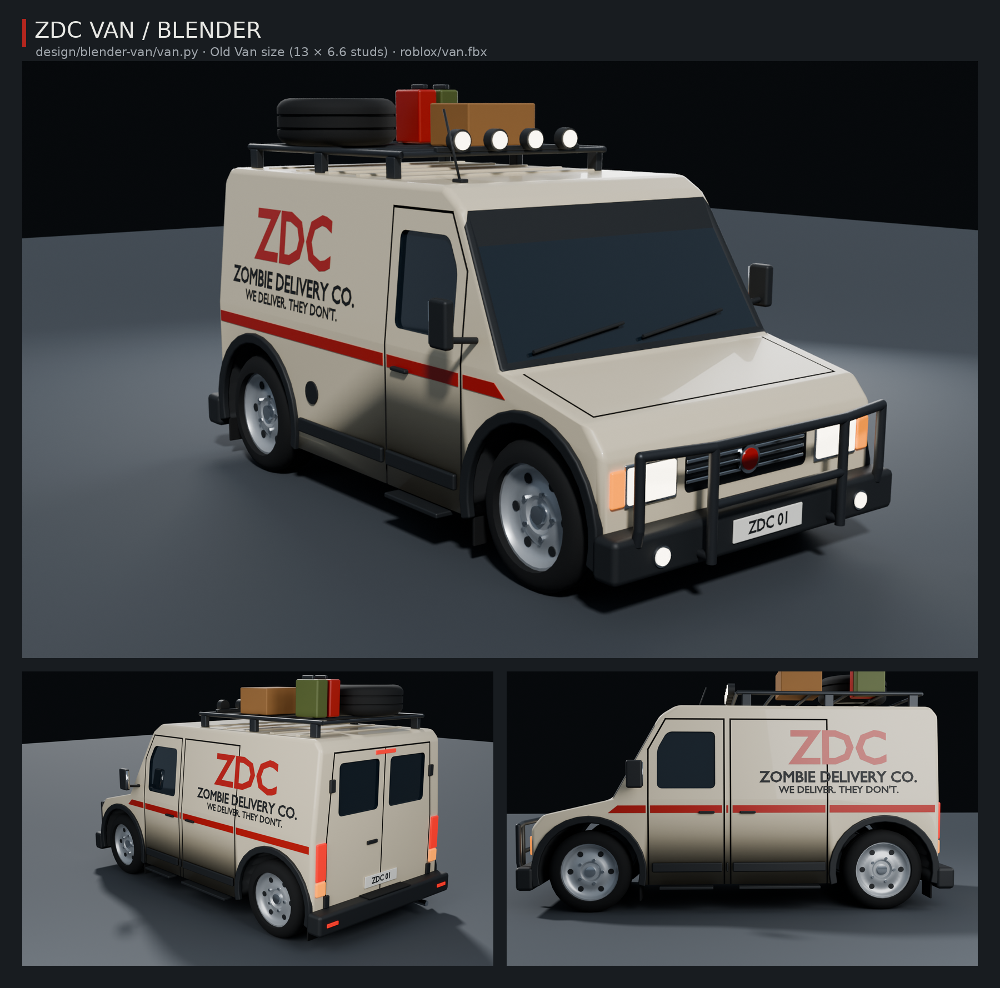

# Dodávka ZDC v Blenderu



Model dodávky pro Zombie Delivery. Má rozměry Old Vanu ze hry (13 × 6,6 studu, kola na stejných místech).
Postavil ho skript `van.py`, takže každou barvu, nápis i míru můžeš změnit a nechat dodávku postavit znovu.

| Soubor | Co to je |
| --- | --- |
| `van.blend` | Hotová scéna: dodávka, světla, kamera. Stačí ji otevřít. |
| `van.py` | Skript, který dodávku postaví (je přibalený i uvnitř `van.blend`). |
| `roblox/van.fbx` | Model připravený pro Roblox Studio (3D Importer). |
| `roblox/van_palette.png` | Malá textura s barvami (64 × 64), kterou FBX používá. |
| `van-preview.png` | Náhled z Blenderu (Cycles). |

## 1. Otevři ji v Blenderu
Dvakrát klikni na `van.blend` (nebo *File → Open*). Je uložená v Blenderu 5.2. Pokud ji tvoje verze neotevře,
otevři prázdný Blender a spusť `van.py` (krok 3): postaví ti úplně stejnou dodávku.

Ovládání v 3D okně:
- **prostřední tlačítko myši** = otáčení, **Shift + prostřední** = posun, **kolečko** = přiblížení;
- **Home** = ukáže celou dodávku, **Numpad 1 / 3 / 7** = zepředu / z boku / shora;
- **Z** = způsob zobrazení (Material Preview ukazuje barvy, Rendered ukazuje světla);
- **F12** = render přes kameru (obrázek se otevře v novém okně).

## 2. Prohlédni si, jak je postavená
Vpravo nahoře je **Outliner**. Dodávka je rozdělená do kolekcí:
- **Van_Body**: karoserie `Body` a všechno, co je na ní (nárazníky, zrcátka, kliky, nápisy, lemy podběhů);
- **Van_Wheels**: 4 kola (`Wheel_FL` = přední levé …);
- **Van_Lights**: světla (svítivý materiál);
- **Van_Kit**: výbava na apokalypsu (rám vpředu, střešní nosič, rezerva, kanystry, bedna, světla na střeše);
- **Van_Cutters**: schované tvary, které do karoserie **vyřezávají okna a spáry dveří**.

Na čem se dá učit:
1. Klikni na `Body` a otevři panel **Modifiers** (ikona klíče vpravo). **Bevel** zakulacuje hrany: zkus změnit
   *Amount* nebo *Segments*. **Boolean** vyřezává okna a spáry: vypni ho ikonou monitoru a uvidíš karoserii bez nich.
2. V Outlineru zapni oko u **Van_Cutters**, klikni na jeden řez okna, zmáčkni **G** a posuň ho. Okno se posune s ním.
3. Klikni na libovolný díl a zmáčkni **Tab**. Jsi v režimu úprav (Edit Mode), kde **G / R / S** posouvá, otáčí
   a zvětšuje vybrané body. **Tab** tě vrátí zpátky.
4. Barvu změníš v panelu **Material** (červená koule vpravo), položka *Base Color*.

## 3. Změň ji skriptem a postav znovu
Nahoře klikni na záložku **Scripting**. V textovém editoru vyber `van.py` (nebo *Open* a vyber soubor `van.py`).
Úplně nahoře je část **NASTAVENÍ**:

```python
PAINT = "#D9CCB0"      # lak karoserie
STRIPE = "#B3261E"     # pruh a logo
LOGO, NAME, SLOGAN = "ZDC", "ZOMBIE DELIVERY CO.", "WE DELIVER. THEY DON'T."
PLATE = "ZDC 01"
KIT = True             # False = dodávka bez výbavy na apokalypsu
LENGTH, WIDTH, HEIGHT = 13.0, 6.6, 6.6
```

Změň, co chceš (například `PAINT = "#2F5D3A"` pro vojenskou zelenou nebo `LENGTH = 15.0` pro delší dodávku),
a zmáčkni **Run Script** (▶ nebo Alt + P). Stará dodávka se smaže a postaví se nová.

## 4. Dostaň ji do Robloxu
Hotový model najdeš v `roblox/van.fbx`. Když dodávku změníš, nastav ve skriptu `EXPORT = True`, ulož `.blend`
(Ctrl + S) a spusť skript znovu. Nové FBX se uloží do složky `roblox` vedle `.blend`.

V Roblox Studiu:
1. Otevři **3D Importer** (nahoře *File → Import 3D*, nebo karta *Home → Import 3D*) a vyber `van.fbx`.
2. V nastavení importu nech **Scale Unit = Stud**. Dodávka má mít i s rámem asi **14 studů na délku**.
   Jestli je obrovská nebo maličká, přepni *Scale Unit*, dokud nesedí.
3. Dej **Import**. Vznikne model s díly `Body`, `Kit`, `Wheel_FL/FR/RL/RR` a `Lights_White/Amber/Red`.
4. Dílům `Lights_White`, `Lights_Amber` a `Lights_Red` nastav ve vlastnostech **Material = Neon** a **Color**:
   bílá, oranžová a červená. Pak budou svítit.

Každý díl má málo trojúhelníků, takže se vejde do limitu Robloxu: karoserie zhruba 10 000, výbava 6 300, kolo 2 500.
Okna jsou tmavá a neprůhledná, jsou součástí karoserie.

Ve hře se zatím jezdí v dodávkách postavených z Robloxích Partů (`src/server/VehicleArt`). Tenhle model je
samostatný. Kdybys chtěl, aby se v něm dalo jezdit, je potřeba ho nahrát do Robloxu (id meshů) a napojit na kód
vozidel. Řekni Claudovi a udělá to.

## Bez Blenderu (pro AI pomocníky)
`pip install bpy` (Python 3.13) a z této složky:
```
python van.py -- --save van.blend --export roblox --render /tmp/van-renders --samples 128
```
Náhled `van-preview.png` je složený ze tří renderů (`van-front.png`, `van-rear.png`, `van-side.png`).
