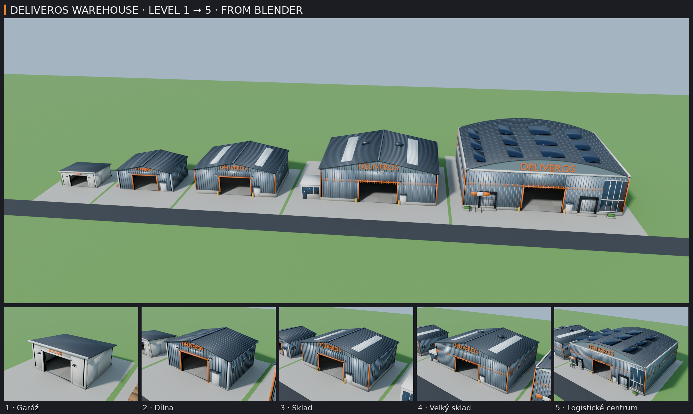
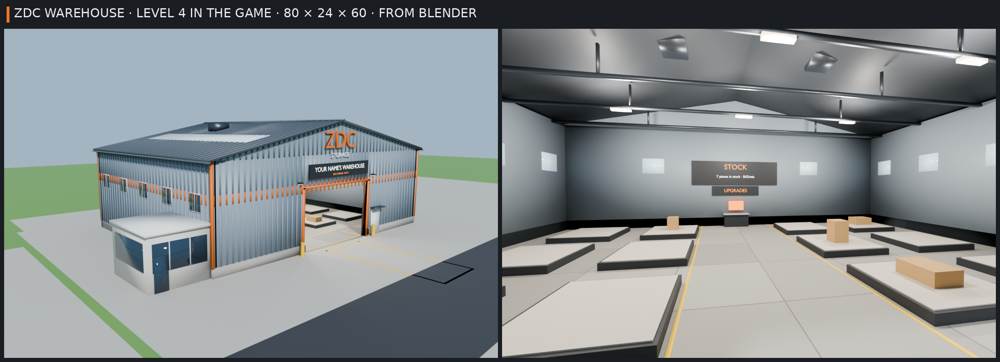

# Sklad ZDC v pěti úrovních (Blender)



Tvůj nápad: sklad se dá vylepšovat od **levelu 1** do **levelu 5** a s každým vylepšením je větší (víc místa na
stojany a další věci, které vymyslíš). Tady je pět modelů v Blenderu, od malé garáže po logistické centrum.
**Od verze 8.3 je ve hře všech pět:** každý hráč má svůj level a další si koupí u pultu UPGRADES (krok 3).

| Level | Budova | Velikost (šířka × výška zdí × hloubka) | Vrata | Stojanů ve hře |
| --- | --- | --- | --- | --- |
| 1 | **Garáž**: omítnutá, pultová střecha, otevřená sekční vrata, boční dveře, okno, popelnice | 26 × 12 × 22 | 14 × 9,5 | 2 |
| 2 | **Dílna**: plechová (vlnitý plech), nízká sedlová střecha, oranžový rám vrat, ZDC na štítu, palety a sudy | 40 × 15 × 30 | 18 × 12 | 4 |
| 3 | **Sklad**: betonový sokl, plech, světlíky ve střeše, nápis ZDC STORAGE, sloupky a nárazníky u vrat | 58 × 19 × 42 | 22 × 14 | 8 |
| 4 | **Velký sklad**: dvoubarevný plášť s oranžovým pruhem, prosklená kancelář na boku, klimatizace na střeše | 80 × 24 × 60 | 26 × 16 | 12 (+ až 8 malých) |
| 5 | **Logistické centrum**: klenutá střecha se solárními panely, dva doky s rampami, prosklený roh, vlajky | 104 × 28 × 84 | 26 × 18 | 24 (+ až 8 malých) |

- **Level 4 má přesně rozměry skladu, který byl ve hře do verze 8.2.** Proto hráč, který hrál už dřív, začíná na
  levelu 4 (nic neztratí) a nový hráč začíná v garáži (level 1).
- Malé stojany (8 × 5) přidává vylepšení **More stands**, a to až od levelu 4 (po dvou, nejvýš 8).
- **Level 5 se ještě vejde na pozemek** (120 × 152) a nic z žádného levelu nezabírá místo, které pozemek potřebuje:
  - místo, kam couvá dodávka (UNLOAD HERE);
  - cestu vraty dovnitř;
  - nástěnku se zakázkami;
  - místo, kde se objevíš;
  - podlahu uvnitř, kam se staví stojany.

  Hlídá to kontrola `tools/warehouse-art/check.py`.
- Všechny budovy mají vrata uprostřed přední zdi (tam, kde jsou dnes) a uvnitř prázdnou podlahu a světla. Pod
  střechou mají ocelové vazníky, garáž dřevěný trám.

| Soubor | Co to je |
| --- | --- |
| `warehouse.blend` | Hotová scéna: pět budov vedle sebe, slunce, kamery. Stačí ji otevřít. |
| `warehouse.py` | Skript, který budovy postaví (je přibalený i uvnitř `warehouse.blend`). |
| `roblox/ZDCWarehouseArt.fbx` | **Model pro hru**: všech pět levelů, každý rozdělený podle povrchu. |
| `roblox/ZDCWarehouseArt.json` | Velikost, vrata, zdi (na kolize) a všechny díly každého levelu. |
| `warehouse-levels.png` | Náhled: celá řada a každý level zvlášť (Cycles). |
| `warehouse-preview.png` | Náhled levelu 4 tak, jak bude ve hře: zvenku a zevnitř, se stojany, pultem UPGRADES, tabulí STOCK a cedulí s tvým jménem (8.2). |

## 1. Otevři ho v Blenderu
Dvakrát klikni na `warehouse.blend`. Je uložený v Blenderu 5.2. Pokud ho tvoje verze neotevře, otevři prázdný Blender a
spusť `warehouse.py` (krok 3): postaví úplně stejnou scénu.

- **prostřední tlačítko myši** = otáčení, **Shift + prostřední** = posun, **kolečko** = přiblížení;
- klikni na budovu a zmáčkni **Numpad .** = přiblíží se na ni, **Home** = ukáže všechno;
- kamery: `Kamera řada` (všech pět) a `Kamera level 1` … `Kamera level 5`. Klikni na kameru v Outlineru a zmáčkni
  **Ctrl + Numpad 0**, pak **F12** = render (hezčí s *Render Engine: Cycles*).

V Outlineru je kolekce **Warehouses** a v ní **Level 1** … **Level 5**. Oko u kolekce ji schová, takže si můžeš
prohlédnout jen jednu budovu, i zevnitř.

## 2. Změň ho skriptem
Záložka **Scripting** → `warehouse.py`. Nahoře je **NASTAVENÍ**, hlavně seznam `LEVELS`:

```python
{"id": 1, "name": "Garáž", "W": 26, "D": 22, "H": 12, "door": (14, 9.5), "roof": "shed", "rise": 2.5, "wall": "plaster", "stands": 2},
```

- `W`, `D`, `H` = šířka, hloubka a výška zdí, `door` = šířka a výška vrat;
- `roof` = střecha: `shed` (pultová), `gable` (sedlová), `barrel` (klenutá), `rise` = jak vysoko jde nad zdi;
- `wall` = plášť: `plaster` (omítka), `metal` (plech), `plinth` (beton dole, plech nahoře), `twotone` (s oranžovým pruhem);
- `FINISHES` pod tím = barvy (třeba `"orange"` je barva ZDC, `"metal"` plech).

Změň, co chceš, a dej **Run Script** (▶ nebo Alt + P). Staré budovy se smažou a postaví se nové. Pak spusť kontrolu
(`tools/warehouse-art/check.py`, krok „pro AI pomocníky“ níže), jestli se pořád vejdou na pozemek. Nebo napiš Claudovi.

## 3. Ve hře (od verze 8.3: všech pět levelů)


Od verze 8.2 hra obléká sklad z kostiček do tvého modelu z Blenderu. **Od verze 8.3 je ve hře všech pět levelů:**
každý hráč má sklad svého levelu a stojí v něm budova toho levelu z Blenderu.

- **Nový hráč začíná v garáži (level 1)** se 2 stojany.
- **Hráč, který hrál už před verzí 8.3, začíná na levelu 4** (Velký sklad, 12 stojanů). To je sklad, který měl
  doteď, takže nic neztratí.
- Volný pozemek (bez hráče) ukazuje garáž s nápisem FOR RENT.

**Jak se kupuje další level:** u pultu **UPGRADES** ve skladu (E) je karta **ZDC Warehouse**:

| Koupíš | Budova | Cena | Velkých stojanů |
| --- | --- | --- | --- |
| level 2 | Dílna (Workshop) | $1,500 | 4 |
| level 3 | Sklad (Storehouse) | $5,000 | 8 |
| level 4 | Velký sklad (Big Warehouse) | $12,000 | 12 |
| level 5 | Logistické centrum (Logistics Center) | $30,000 | 24 |

- Po koupi se sklad hned přestaví na větší budovu. Kusy, které máš vystavené, zůstanou na svých stojanech (stojan se
  nikdy nezmenší).
- **More stands** (malé stojany 8 × 5, po dvou) jde koupit až od levelu 4. Pod ním je karta zamčená s nápisem
  „Needs the Big Warehouse“. Na levelu 4 tedy můžeš mít 12 až 20 stojanů, na levelu 5 24 až 32.
- Admin panel (**P** → **SANDBOX**): **⬆ MAX UPGRADES** dá level 5 (a všechno ostatní naplno), **↺ RESET UPGRADES**
  vrátí garáž (level 1), **🏗 LV 1** … **🏗 LV 5** postaví sklad rovnou na tom levelu (ostatní vylepšení zůstanou).
  Kusy ze stojanů, které tím zmizí (nebo se na menší stojan nevejdou), se vrátí do skladu (STOCK).

**Nic znovu nahrávat nemusíš.** Model, který máš ve Studiu naimportovaný, už obsahuje všech pět levelů. Pokud ho
ještě naimportovaný nemáš, udělej to podle kroků níže. Roblox zobrazí 3D model jen tehdy, když je nahraný pod tvým
účtem, a k tvému účtu se nepřihlásím. Do té doby stojí každý level z kostiček (stejně velký, se stejnými stojany).

Mění se jen vzhled. Všechno ostatní zůstává z dílů hry (`src/server/Warehouse.luau`, rozměry každého levelu jsou
v `src/shared/WarehouseLayout.luau` a `Config.Warehouse.Levels`):
- **kolize:** každý level má neviditelné zdi a střechu tam, kde je má model (střecha hry je celá pod střechou
  modelu), u větších levelů i sloupky u vrat. Věci venku, do kterých narazíš, mají svůj neviditelný blok: popelnice
  u garáže, palety a sudy u dílny, kancelář u velkého skladu, rampy a truhlíky u logistického centra;
- stojany a věci na nich, pult UPGRADES, tabule STOCK, cedule s tvým jménem nad vraty;
- žluté čáry na podlaze a místo UNLOAD HERE před vraty (to je u všech levelů stejné);
- světla v hale: svítí z lamp modelu.

Aby to sedělo, upravil Claude v 8.2 level 4 v `warehouse.py` podle dílů hry (zvenku skoro stejný):
- zdi jsou tlusté 1 stud jako ve hře;
- podlaha je nízko pod nápisy na podlaze a má betonové desky ve třech odstínech se spárami;
- vazníky a světla v hale visí tam, kde má hra lampy;
- žluté sloupky u vrat stojí tam, kde má hra své.

V 8.3 se model neměnil. Naopak díly hry každého levelu stojí podle modelu: zdi, střecha, lampy pod jeho světly,
stojany a pult tam, kde nic z modelu nepřekáží.

Jednou ve Studiu (s hrou otevřenou jako obvykle), jen pokud model ještě nemáš:
1. *File → Import 3D* (nebo karta *Home → Import 3D*) a vyber `design/blender-warehouse/roblox/ZDCWarehouseArt.fbx`.
2. Nastavení nech, jak je, a dej **Insert / Import**. Ve Workspace se objeví model `ZDCWarehouseArt` (všech pět
   levelů vedle sebe). Může zůstat, kde je: hra si ho při spuštění sama schová do ServerStorage. Nebo ho v Exploreru
   přetáhni do **ServerStorage** sám. **Nepřejmenovávej ho.**
3. Ulož místo (*File → Save*, Ctrl + S) a *File → Publish to Roblox*, ať ho má i hra na Robloxu.

Vyzkoušení: dej **Play** a na úvodní obrazovce **PLAY**. Stojíš u svého skladu (jako nový hráč u garáže). Vejdi vraty
dovnitř, u pultu UPGRADES kup další level (peníze: admin panel → SANDBOX → **💰 +$10K**) a dívej se, jak sklad roste.
Nebo: **P** (admin panel) → záložka **SANDBOX** → **📍 TO WAREHOUSE**.

Když sklad v Blenderu změníš: nastav `EXPORT = True`, ulož `.blend` (Ctrl + S) a spusť skript. Ve Studiu pak smaž
starý `ZDCWarehouseArt` a naimportuj nový `roblox/ZDCWarehouseArt.fbx` (krok 1 až 3). U žádného levelu neměň rozměry
(`W`, `D`, `H`, `door`, `rise`): každý je ve hře a hra by level jiné velikosti odmítla (stál by z kostiček). Kontroly
v kroku „pro AI pomocníky“ řeknou, jestli pořád sedí. Barvy ve hře nastavuje tabulka `LOOKS` v
`src/server/WarehouseMesh.luau`, ne Blender: když v Blenderu změníš barvu, řekni Claudovi.

## Pro AI pomocníky
`pip install bpy` (Python 3.13) a z této složky:
```
python warehouse.py -- --save warehouse.blend --export roblox --render /tmp/warehouse-renders --samples 64
```
Render udělá `levels.png` (řada) a `level-1.png` … `level-5.png`, z nich je složený `warehouse-levels.png`.

V `roblox/ZDCWarehouseArt.json`:
- každý level má velikost, vrata, návrh stojanů z Blenderu (`stands`; hra má své počty v `Config.Warehouse.Levels`,
  u levelu 5 24 místo 20) a `collide` (zdi, se kterými by hra kolidovala) a `details` (každý díl);
- souřadnice jsou v ose hry od středu vrat na zemi (x doprava, y nahoru, z dovnitř);
- díly ve FBX se jmenují `lvl<N>_<povrch>` a značky `mark_o/x/y/z` a `mark_lvl<N>` (počátek levelu);
- 8.2: `mark_lvl<N>_box` (roh budovy: W / 2, H, D), `mark_lvl<N>_door` (roh vrat) a `mark_lvl<N>_top` (vršek střechy)
  říkají hře, jak velký level je; krabice `collide_lvl<N>_<k>` jsou neviditelné bloky věcí mimo zdi (kancelář, palety,
  rampy…). V JSON k nim patří `marks`, `solids` a `floorTop` u každého levelu.

`python3 zombie-delivery/tools/warehouse-art/check.py <luau>` ověří proti `shared/SandboxMap.luau` a `Config.Warehouse`:
- level 4 = dnešní sklad;
- každý level je větší;
- všechno je na pozemku a mimo místa, která pozemek potřebuje.

8.2, 8.3: `python3 zombie-delivery/tools/warehouse/mesh-check.py <luau>` (spouští ho i `tests/run_tests.py`)
naimportuje model podle JSON (otočený a zvětšený jako ve Studiu) a oblékne s ním sklady:
- 8.2: sklady, které staví skutečný `src/server/Warehouse.luau`, na všech čtyřech pozemcích;
- 8.3: **každý level 1 … 5** na svém místě (`WarehouseLayout.site(pozemek, level)`), postavený z
  `WarehouseLayout.pieces` jako ve hře.

U každého levelu hlídá:
- značky levelu (budova, vrata, vršek střechy) = rozměry levelu ve hře, jinak by ho hra neoblékla;
- každý díl na svém místě, ukotvený a bez fyziky;
- schované jsou jen díly, které jsou jen vzhled, a pevné z nich pořád kolidují; stojany, pult, cedule a výzvy
  zůstávají;
- neviditelné zdi hry jsou uvnitř zdí modelu, štíty uvnitř jeho štítů a střecha hry celá pod střechou modelu (v každém
  bodě, přesně podle tvaru střechy z `warehouse.py`, ne jen podle krabice kolem ní);
- každé světlo hry svítí těsně pod lampou modelu;
- nic z modelu nezasahuje do stojanů, pultu, cedulí, čar na podlaze, vrat, cesty dovnitř ani místa UNLOAD HERE;
- bez importu, s jinak velkým skladem nebo levelem se nic nezmění.

Náhled `warehouse-preview.png` (level 4 s díly hry, zvenku a zevnitř) z kořene `zombie-delivery/`:
```
python tools/warehouse/preview.py -- --samples 96
```
