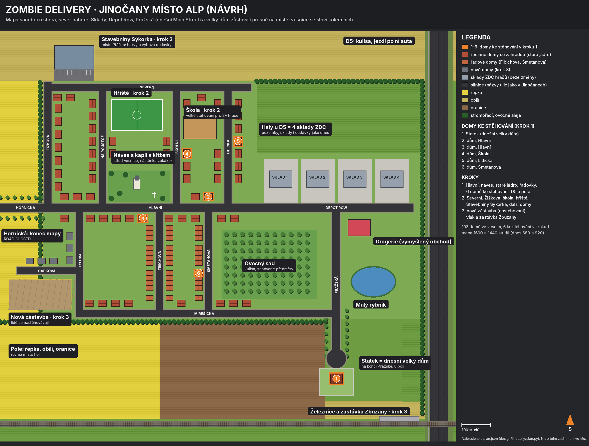

# Jinočany místo Alp (návrh)

Toto je jen plán, ve hře se zatím nic nemění. Týká se **sandboxu**, tedy hry, kterou teď testujete
(`Config.Sandbox.On = true`). Alpský vzhled sandboxu se vymění za vesnici podle skutečných Jinočan. Pozemky, sklady,
dodávky, stěhování, sbírka a vylepšení fungují dál stejně.

Čísla tady pocházejí ze skutečného kódu (`shared/SandboxMap.luau`, `tools/perf/sandbox_count.py`). Celý plán je jako
data v `plan.json` a obrázek v `plan.png`; obojí vyrábí `plan.py` vedle tohoto souboru. Druhá, anglická část je návod
pro agenty.

## Krátce

- **Velikost:** mapa **1 600 × 1 440 studů** (dnes 680 × 920), tedy asi 3,7× větší plocha. Skutečné Jinočany by ve
  velikosti postav měřily asi 6 000 studů, proto jsou vzdálenosti zhruba čtyřikrát kratší a domy mají velikost jako dnes.
- **Na místě zůstane:** 4 pozemky se sklady ZDC, Depot Row, Main Street (nově **Pražská**), obratiště a velký dům na
  jejím konci (nově **Statek**, anglicky „The Old Farmstead“). Hráči začínají u svých skladů jako dnes.
- **Nové:** ulice Hlavní přes celou vesnici, **náves s kaplí a křížem**, staré jádro, řadovky, ovocný sad, rybník,
  drogerie, pole a D5 jako okraj mapy. Celkem **103 domů**, z toho **6 ke stěhování** v kroku 1 (Statek + 5 nových).
- **Zmizí:** smrky, prstenec zasněžených hor, kravské zvony, vzhled chaty a cedule THE OLD CHALET.
- **Jízda:** k domům se jezdí 300–1 000 studů podle skladu a domu (dnes ke statku 670–800). Cesty tedy zůstanou podobně
  dlouhé.
- **Uložené hry:** nic se nepřevádí. Pozemek se přiděluje při každém připojení a nikam se neukládá; sbírka a vylepšení
  na mapě nezávisí.

## Co je ve hře čím

| Skutečné Jinočany | Ve hře | Krok |
| --- | --- | --- |
| Nové haly u D5 (u Malvíku) | 4 sklady ZDC hráčů, beze změny | 1 |
| Pražská | dnešní Main Street, jen přejmenovaná | 1 |
| Hlavní | hlavní ulice od skladů na západ přes celou vesnici | 1 |
| Náves s kaplí a křížem | střed vesnice: kaple, kříž, lípy, lavičky, nástěnka se zakázkami | 1 |
| Staré jádro (Školní, Lidická, Na Pouštce) | rodinné domy se zahradou | 1 |
| Řadovky (Fibichova, Smetanova) | řadové domy po čtyřech | 1 |
| Mirešická | jižní ulice podél polí | 1 |
| Malý rybník | rybník u Pražské | 1 |
| Drogerie (dm) | vymyšlená „Corner Drugstore“, jen kulisa | 1 |
| Pole kolem vesnice | řepka, obilí, oranice, stromořadí, ovocné aleje | 1 |
| Dálnice D5 | okraj mapy na východě: násep, protihluková stěna, jezdí po ní auta (jen kulisa) | 1 |
| Hornická | konec mapy na západě (ROAD CLOSED) | 1 |
| Škola | velké stěhování pro dva a více hráčů | 2 |
| Fotbalové hřiště | místo pro akce a denní úkoly | 2 |
| Stavebniny Ptáček | vymyšlené **Stavebniny Sýkorka** („Sýkorka Building Supplies“) | 2 |
| Severní, Žižkova | severní ulice ke stavebninám | 2 |
| Nová zástavba (Čapkova, Tylova) | moderní domy a staveniště; lidé se sem **nastěhovávají** | 3 |
| Železnice, zastávka Zbuzany | vlak projíždí (kulisa), zastávka | 3 |

## Co se vymění (Alpy → Jinočany)

| | dnes | v Jinočanech |
| --- | --- | --- |
| zem | louka s mírnými kopečky | rovina: pole s řádky (řepka, obilí, oranice), zahrady a trávníky ve vesnici |
| stromy | alpské smrky a jedle | lípy, duby, břízy; ovocné stromy v alejích a v sadu |
| okraj mapy | ohrada, zelené kopce a skalnaté štíty se sněhem | rovný obzor: pole, stromořadí, D5 s auty, stožáry vedení, v dálce střechy Zbuzan |
| velký dům | chata (náhradní vzhled) a brána THE OLD CHALET | váš model z Blenderu zůstává (už je to evropský dům), brána THE OLD FARMSTEAD, náhradní vzhled český statek |
| zakázka | „The Hubers, the end of Main Street“ | vymyšlené české rodiny (třeba „The Nováks“), adresa podle ulice |
| zvuky | louka a vzdálené kravské zvony | ptáci a skřivani nad poli, vzdálené hučení D5 (od východu), občas zvon z kaple, pes, traktor; v kroku 3 vlak |
| světlo | „teplé alpské odpoledne“ na 47° severní šířky | stejné teplé letní odpoledne na 50° (Jinočany) |

## Kroky

1. **Malé Jinočany:** Hlavní, náves, staré jádro, řadovky, Mirešická, sad, rybník, drogerie, pole a D5. Stěhovat jde
   **6 domů**: Statek (velký dům jako dnes) a 5 rodinných domů (2 na Hlavní, Školní, Lidická, Smetanova). Kiosek
   u skladu nabídne zakázku na jeden z nich. Tohle je největší změna v kódu: dnes hra počítá s jediným domem.
2. **Celá vesnice:** Severní a Žižkova, škola (velké stěhování pro 2+ hráče), hřiště, Stavebniny Sýkorka a dalších
   asi 6 domů ke stěhování.
3. **Navíc:** nová zástavba, kde se lidé nastěhovávají (vozíte věci ze skladu do domu; to je nová mechanika a potřebuje
   vlastní návrh, protože bere věci ze sbírky), vlak a zastávka Zbuzany.

## Názvy, značky a soukromí

- **Texty ve hře zůstávají anglicky.** Jinočany a názvy ulic (Hlavní, Školní, Pražská …) jsou vlastní jména a zůstanou
  česky i s háčky. Ve Studiu je potřeba ověřit, že písmo ve hře háčky a čárky ukáže.
- **Žádné skutečné značky ani loga:** ne Ptáček, dm ani Malvík. Místo nich vymyšlené Stavebniny Sýkorka a Corner
  Drugstore.
- **Žádné skutečné adresy ani lidé:** čísla domů a jména rodin jsou vymyšlená, domy vypadají obecně (nejsou to kopie
  konkrétních skutečných domů) a ve hře se neoznačuje ničí skutečný domov.
- Satelitní snímek do repa nepatří (patří poskytovateli map). Plánek je nakreslený znovu z vlastních dat.

## Výkon

Dnes má mapa sandboxu **985 dílů** (strop `SandboxScenery.Budget` je 2 500). V nejhorším případě (4 hráči, plné
stojany, 4 dodávky, jedno stěhování s Dannym, návštěvníci) je ve světě **6 835 dílů**; když stěhují všichni čtyři,
**9 703** (`tools/perf/sandbox_count.py`).

Odhad pro krok 1: 86 domů po nejvýš 15 dílech ≈ 1 300, silnice, pole, stromy, náves a D5 ≈ 1 000–1 200, tedy **asi
2 300–2 500 dílů**, pod dnešním stropem. Nejhorší případ vyjde asi na 8 300 a se čtyřmi stěhováními asi na 11 000.
Domy proto musí být lehké (jedna krabice, střecha, dveře, okna, plot), vzdálené domy se posílají po kouscích
(streaming) a skutečný počet se změří stejným nástrojem, než se změna sloučí.

## Rizika

- **Víc domů ke stěhování.** S jediným domem (`SandboxMap.House`) dnes počítá 13 dalších souborů. Je to největší kus práce.
- **Souběh s hlavní session.** Ta teď na sandboxu pracuje (Danny, dveře domu, dodávka). Mapu proto musí stavět ona,
  jinak se změny srazí.
- **Háčky v písmu** (viz výše).
- **Model z Blenderu** obléká jen velký dům; ostatní domy se skládají z dílů.

## Co prosím rozhodnout

1. **Statek:** přejmenovat velký dům na „The Old Farmstead“ (Statek)? Doporučuji ano.
2. **Počet domů v kroku 1:** navrženo 6 (Statek + 5). Víc domů znamená víc práce, ale pestřejší zakázky.
3. **Stavebniny Sýkorka (krok 2):** přesunout tam lakovnu dodávky, aby byl důvod tam jezdit, nebo jen kulisa?
4. **Město a plán alpského údolí:** město (`Config.Sandbox.On = false`) je vypnuté a má alpské úpravy z kroku 1 i
   plán `design/rework/MAPA-KROK2.md`. Doporučuji město teď nechat být a plán alpského údolí odložit.
5. **Háčky v názvech ulic:** nechat (doporučeno), nebo psát bez nich?

## Jak se to postaví

Postaví to hlavní session, protože svět sandboxu je její. Pořadí: nejdřív data mapy a několik domů ke stěhování
(kód stěhování), pak vzhled vesnice a kulisy, potom zvuky a texty. Každý krok projde testy a měřením dílů jako dnes.

---

# Technical plan (English, for the agents)

Source of truth: `design/jinocany/plan.json`, written by `plan.py` (deterministic). Units and axes as
`shared/SandboxMap.luau`: studs, x east, z south (-z north), a spot's yaw 0 north / 90 west / 180 south / 270 east. A
house's `door` is outside its front door looking out; its `curb` is the van's pivot as `SandboxMap.House.curb` (the
Sprinter, 22 long, across the road, its back 2 studs in from the house's edge of the road, its nose away from the
door). `plan.py` checks on every run: the curbs of all 103 houses (the village's 102 and the farmstead) have the van's back and
nose on asphalt, the back nearer the door.

Scope: the sandbox only. The city (`Config.Sandbox.On = false`: `Map.luau`, `server/Alpine.luau`, `Chalets.luau`,
`Hauptplatz.luau`, `MAPA-KROK2.md`) stays as it is.

## 1. What stays (fixed, copied into plan.json with `fixed`)

- `SandboxMap.Plots` (all four: rects, warehouses, doors, van spots, unload circles, spawns, boards), `DoorWidth`,
  `VanGap`, `GroundTop`, `RoadTop`.
- The roads `Depot Row` (x -270…270, z -74…-46) and Main Street (x -14…14, z -46…470), renamed **"Pražská"**,
  the `Turnaround` (0, 470, r 34).
- `SandboxMap.House` (id `sandbox_house`, its lot, box, door, curb, back): renamed **"The Old Farmstead"**; still the
  big house (`Config.Moving.Sandbox.Kind = "big"`) and the only one `server/HouseMesh.luau` dresses.

## 2. Data (`shared/SandboxMap.luau`)

- `Bounds` = `plan.bounds` (x -1180…420, z -680…760).
- `Roads` = `plan.roads` (all axis-aligned rects; step 1 the ones with `step = 1`). "Main Street" is referenced by name
  in 12 files (`SandboxMap`, `SandboxSteps`, `SandboxScenery`, `Config`, `SoundPlan`, `SandboxLeadersRules`,
  `SandboxLeaders`, `Moving`, `SandboxWorld`, `Menu`, `SandboxGuide`, `SoundScape`): rename it everywhere.
- New `SandboxMap.Houses`: `plan.enter` (6 houses: id, name, kind `big` / `house`, box, door, curb, yaw). Keep
  `SandboxMap.House = SandboxMap.Houses[1]` while the 13 other files that read `SandboxMap.House` move over (`SandboxSteps`,
  `SandboxScenery`, `MoveSiteLooks`, `Config`, `SandboxAdmin`, `SoundPlan`, `Admin`, `SandboxBoot`, `HouseMesh`,
  `Moving`, `SandboxWorld`, `Menu`, `SandboxGuide`).
- New `SandboxMap.Village`: `plan.houses` (decoration: kind `old` / `row` / `modern`, box, yaw, step) and
  `SandboxMap.Landmarks`: `plan.landmarks` (rects and kinds).

## 3. Moves (`server/Moving.luau`, `server/MoveSites.luau`, `Config.Moving.Sandbox`)

- A contract per house: `Config.Moving.Sandbox` becomes a list (or a table by house id) with a fictional Czech client
  ("The Nováks" …), the address by street, `Kind` (`big` for the farmstead, `house` for the rest: HouseLayout's kinds),
  `Time`. The kiosk offers one (rotate, or the next free one: two players never on the same house at once).
- `SB.site` (Moving.luau ~1039, ~1106) and the "Call truck to door" spot take the contract's house; `HouseInterior`
  builds that house's plan far off as today; the back door (`House.back`) only where a house has one (the farmstead).
- Every house's front door gets the `SandboxDoor` part and the walk-in hall like the farmstead's (SandboxWorld's door
  halls, `Config.Moving.Doors`).

## 4. The world (`shared/SandboxScenery.luau`, `server/SandboxWorld.luau`)

- Ground: `plan.fields` as tiles in their crop's colour (rows as a texture or thin strips), the village's lawns
  (`plan.village`), flat (no mounds). The roads' shoulders and markings as today for every road.
- Trees: replace the alpine spruces (`AlpineLayout`'s two-part trees) with deciduous trees (trunk + one round crown;
  lime, oak, birch tones) along `plan.treeLines` and in the orchard; never on a road, a lot, a curb or a van's way
  (today's rules).
- Houses: a new pure module (e.g. `shared/VillageLooks.luau`, tested like `ChaletLooks`): a Czech family house (render,
  a red tile gable roof, door, windows, garden fence), the terraced row (one body per group of four), the modern box;
  **at most 15 parts each**, Atomic per chunk for streaming. The six houses to empty a little richer.
- Landmarks: the chapel green (chapel with a small tower, the cross, limes, benches, the contracts noticeboard), the
  pond (water a hair under its rim), the drugstore, the D5 (embankment, noise wall, asphalt; a few cars that move only
  on the clients), Hornická's ROAD CLOSED barrier at the west edge; step 2 and 3 landmarks later.
- The far horizon (outside `Bounds`): flat far fields, tree lines, pylons, a few far roofs; no peaks.
- `SandboxScenery.Budget`: the map at most 2,500 parts in step 1 (measure with `tools/perf/sandbox_count.py`).
- Lighting (`SandboxWorld.lighting`, Config): `Latitude` 47 → 50, the same warm afternoon.

## 5. Sounds and texts

- `client/SoundScape.luau`, `Config.Soundscape.Sandbox`, `shared/SoundPlan.luau`: the cowbells (`CowbellGap`,
  `CowbellFar`) and the alpine meadow go; birds and larks, the D5's far hum (3D from the east), the chapel's bell now and
  then, a far dog and tractor. New sounds need the owner's upload (sfx sheet): stand-ins until then, as today.
- "The Old Chalet" / "THE OLD CHALET" in src, tests and docs (20 files: 8 in src, 9 tests, 2 docs, the README 9 times) → "The Old Farmstead".
- The sandbox guide (`SandboxSteps`, `SandboxGuide`) names the contract's house, not "the house at the end of Main
  Street".

## 6. Tests

- Update the tests that name the chalet or Main Street (`sandboxworld_test`, `sandboxsteps_test`,
  `sandboxmove_runtime_test`, `sandbox_e2e_runtime_test`, `bigdanny_runtime_test`, `vanmove_test`, `movesites_test`,
  `movehelper_test`, `biglayout_test`).
- New checks: no house, tree or landmark on a road; every house's door faces its road; every curb's van on asphalt,
  back to the door (as `plan.py` checks); every curb reachable by road from Depot Row; a move on each of the six houses
  (runtime); the part budget.

## 7. Acceptance

`python3 tests/run_tests.py <luau>` and `python3 tools/phone-ui/check.py <luau>` pass; `tools/perf/sandbox_count.py`
shows the map within its budget; in Studio: join, take a contract for each of the six houses, drive there, empty it,
drive home and unload; the D5's cars, the sounds, no alpine piece left in the sandbox.
