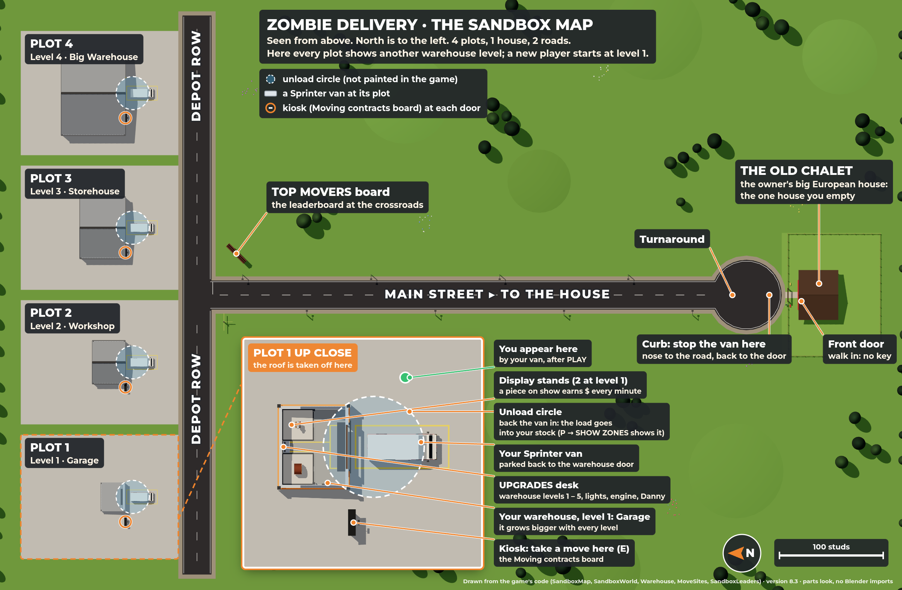

# Zombie Delivery sandbox: the guide

This page explains the sandbox game you test in Roblox Studio. It covers what is in the game, the controls on each
device, the admin tools and how to test each part. The old city is switched off and plays no part here.

The guide describes version **8.3** (Claude's branch). Things marked **(8.3)** reach your game when 8.3 lands on `main`.
Until then, the start screen says 8.2.1.

[](map.png)

*The map from above, drawn from the game's code (click it for full size). North is to the left. Each plot here shows a
different warehouse level so you can compare them. A new player starts at level 1, the Garage.*

## 1. What's in the game

One house to empty, two roads and four plots (one per player). Each plot has a ZDC warehouse, a kiosk and a parking
spot for your Sprinter van.

**The loop**
1. **PLAY** on the start screen. You stand on your plot. Your Sprinter waits by the warehouse door, nose to the street.
2. **The kiosk** (the Moving contracts board by your warehouse door): press E, then **START** on "The Old Chalet", then
   **LAUNCH**. Danny, your helper, waits at the van. A move lasts 20 minutes at most.
3. **Drive** the Sprinter down Main Street to the house at the far end. Turn in the turnaround and stop at the curb
   with the van's back to the house. Open the back doors.
4. **The house** is the owner's big European house (8.2.1). Walk into the front door; no key is needed. It is filled
   with a new random layout every move, with 2 to 4 collectibles.
5. **Carry.** **Pick up** starts the grip check: press while the needle is in the green zone. While you carry, a
   **WOBBLE!** check comes now and then. Heavy pieces need two people: Danny or a friend takes the other end. Load
   pieces at the van's back doors, or walk into the van and load inside.
6. **Home.** Back the van into the **unload circle** on your own plot. The load goes into your warehouse stock ("Trip
   1 home"). Make more trips, then press **FINISH** on the move's panel (twice, to confirm). Anything still in the
   van when the move ends is lost.
7. **Stands.** In the warehouse, press E at an empty stand and pick a piece. A piece on show earns money every minute
   you play; its tag shows how much.
8. **Income, selling and upgrades.** Your money grows on its own. Sell a piece any time by holding F at its stand, or
   use the 📦 STOCK list (**FILL BEST**, **SELL…**, **TAKE ALL DOWN**). Spend the money at the **UPGRADES** desk.

The hint line at the top and the glowing path on the ground always show the next step.

**The rest, one line each**

| Part | What it does |
| --- | --- |
| Market (8.3) | Every day (from midnight UTC) 3 kinds are 🔥 hot: they sell for ×1.6 and earn ×1.25 on show. One kind is ❄ cold and sells for ×0.7. Each piece of one kind you sell lowers its price for you by 5 % (40 % at most). The price recovers 5 % every 20 minutes. |
| 📖 Book (C) | All 68 pieces the house can hold (8.3: 44 furniture, 24 collectibles). Unknown ones are dark. Milestones pay once: 10 found $250, 20 found $500, all furniture $1,500, every collectible $5,000, a legendary $750. |
| 📋 Tasks (J) | 3 daily tasks and 1 weekly task. **CLAIM** pays, and finishing all three dailies adds a $500 bonus. New tasks come at midnight UTC; the weekly one changes on Monday. |
| Leaderboards | The player list shows 💰 $, 📈 $/min and ⭐ Collection. The **TOP MOVERS** board at the crossroads ranks this server's players by what their collection is worth, with each player's all-time best. |
| Warehouse levels (8.3) | The **ZDC Warehouse** card: 1 Garage (2 stands, the start), 2 Workshop (4 stands, $1,000), 3 Storehouse (8, $7,500), 4 Big Warehouse (12, $30,000), 5 Logistics Center (24, $100,000). After a purchase the building is rebuilt bigger on the same spot; your pieces stay on their stands. **More stands** (+2 small stands a level) opens at the Big Warehouse: 12 – 20 stands there, 24 – 32 in the Logistics Center. An existing save starts at level 4, the warehouse it had. |
| Upgrades | At the UPGRADES desk: the warehouse level (8.3), **More stands** (from the Big Warehouse on), **Showroom lights** (+10 % income a level, 5 levels), **Van engine** (+5 % top speed, 3 levels) and **Danny's training** (he walks 10 % faster a level, 3 levels). |

## 2. Controls

| Action | Computer | Gamepad | Phone / tablet |
| --- | --- | --- | --- |
| Walk | W A S D | left stick | thumbstick |
| Run | hold Shift | press the left stick | SPRINT |
| Jump | Space | A | jump button |
| Use a prompt (kiosk, Pick up, Load, Display, UPGRADES desk) | E | X | tap the prompt |
| Get in the van / get out | E (Space also gets you out) | X | tap the prompt / EXIT |
| Drive, steer | W S, A D | R2 gas, L2 brake and reverse, left stick | thumbstick |
| Horn | H | – | – |
| Grip check (press in the green zone) | left mouse or F | R2 | GRIP |
| Put down what you carry | G | B | PUT DOWN |
| Sell a piece on a stand | hold F | hold Y | hold the Sell prompt |
| Take a piece out of the van | hold Z | hold Y | hold the prompt |
| Danny's orders (8.3) | click Danny, then 1–4 | L1 ("Talk to Danny") | tap Danny |
| 📦 STOCK list | B | D-pad ← (8.3) | tap 📦 |
| 📖 BOOK | C | D-pad → (8.3) | tap 📖 BOOK |
| 📋 TASKS | J | D-pad ↓ (8.3) | tap 📋 TASKS |
| Close a window | Esc | B | ✕ |
| Hide or show the guide | hold G | hold B | ✕ on the hint line, then 💡 to bring it back |
| The move's list | O | – | tap the move's panel |
| Quick chat on a move | hold T | – | 💬 |
| Admin panel | P | – | ADMIN (top right) |

Danny's orders are **AUTO** (he carries light things alone and asks for help with heavy ones), **HELP ME**, **WAIT
HERE** and **WAIT AT VAN**. The key hints at the top right show the buttons of the device you used last (8.3).

## 3. Admin panel (P) → SANDBOX

Press **P**. The SANDBOX tab opens first. Every button acts on the player picked as **TARGET** at the top (you by
default). The answer appears in the panel's footer.

| Group | Button | What it does |
| --- | --- | --- |
| Money | 💰 +$10K | Gives $10,000. |
| | 💸 MONEY 0 | Sets the money to $0 (to test being broke). |
| Moves | 🏠 REFILL HOUSE | Ends a running move. The next START fills the house with a new layout. |
| | ▶ START MOVE | Starts a move at once, without the kiosk. |
| | ⏩ SKIP CLOCK | Leaves one minute on the move's clock. |
| | 🧟 HORDE NOW | Sends the zombie horde (it is off in the sandbox otherwise). |
| Collection | 📦 FILL STOCK | Adds 10 random pieces in random condition to the stock. |
| | 🗑 CLEAR STOCK | Empties the stock. No money is paid for it. |
| | ⭐ FILL STANDS | Puts stock pieces on the free stands. |
| | 📖 FILL BOOK / 📖 CLEAR BOOK | Marks every book piece as found (its milestones pay) / empties the book (they can pay again). |
| Travel and the van | 🚐 BRING VAN | Parks the van on the TARGET's plot, back to the door. |
| | 📍 TO HOUSE / 📍 TO WAREHOUSE | Teleports the TARGET there, with the van they are driving. |
| Debug | 🔍 SHOW ZONES | On your screen only: the unload circles, the house's curb, the stands and the vans' cargo bays. |
| Upgrades | ⬆ MAX UPGRADES | Every upgrade at its top for free (the Logistics Center with 32 stands). |
| | ↺ RESET UPGRADES | No upgrades: back to the Garage. Pieces on lost stands go back to the stock. |
| | 🏗 LV 1 … 🏗 LV 5 (8.3) | Sets the warehouse to that level for free (the other upgrades stay). Pieces on lost stands, or too big for a smaller stand, go back to the stock. |
| | 🎨 UNLOCK PAINTS / 🎨 RESET PAINTS (8.3) | Gives every van paint and livery / none (the van back in ZDC cream). |

## 4. How to test

The full two-player checklist is [TEST-STUDIO.md](TEST-STUDIO.md) (17 sections, in Czech). Below is the short version.

**Once per place**
- [ ] Workspace → **StreamingEnabled** on.
- [ ] Lighting → **Technology = Future**. Scripts cannot set it. The sandbox switches off any extra Bloom or SunRays
      from the place template by itself.
- [ ] Game Settings → Security → **Enable Studio Access to API Services**, or nothing is saved in Studio.
- [ ] The Blender imports (section 5).

**Every test**
- [ ] Sync (section 6), then Rojo → Connect, then Play. The Output says `Zombie Delivery <version> SANDBOX is running`
      and shows no red lines.
- [ ] A quick loop alone: PLAY → kiosk → drive → house → grip check → load → unload circle → display → wait one minute
      (the money grows) → sell.
- [ ] Two players: Test tab → Clients and Servers → Local Server, 2 players. Then work through TEST-STUDIO.md. With
      8.3, its sections cover the warehouse levels too.

**New in 8.3**
- [ ] Danny: click him and try all four orders. Lift a two-person piece: you wait while he walks to the other end.
- [ ] Market: the STOCK list shows "Today's market" and 🔥 HOT / ❄ COLD tags. Sell three pieces of one kind: each
      next one sells for 5 % less.
- [ ] Warehouse levels: buy level 2 at the UPGRADES desk ($1,000). The building grows and your pieces stay. Also try
      admin 🏗 LV 1 to LV 5.
- [ ] Light: inside the house you can see your character clearly. Walking into the warehouse does not flash white;
      the light eases in.
- [ ] Paint shop: **🎨 Paint van** at your van, while it is parked on your plot.

**On a phone (in Studio)**
- [ ] Turn on the device emulator (Test tab → Device) with a phone held sideways, or add a custom device of
      **844 × 390**.
- [ ] Every button can be tapped and nothing overlaps: the chips 📦 📖 📋, GRIP during a grip check, PUT DOWN while
      carrying, 💡, tapping Danny, and the prompts. Windows fit on the screen. No keyboard keys show in the texts.
- [ ] Test on a real phone too. If it drops below 30 FPS, try Lighting → Technology = ShadowMap.

**With a gamepad:** plug it in. The key hints show its buttons, and the D-pad's ← → ↓ open STOCK, BOOK and TASKS.

## 5. Blender imports

Roblox shows a 3D model only when it is uploaded under your account, so you import these yourself. Until you do,
the game uses its own block look, and nothing breaks.

| Model | Folder (step-by-step guide) | When to import |
| --- | --- | --- |
| `ZDCHouseArt` | [blender-house](../blender-house/NAVOD.md) | Once. If you imported the small house in 8.1, delete it first. |
| `ZDCSprinterArt` | [blender-sprinter](../blender-sprinter/NAVOD.md) | Once (unchanged since 8.0). |
| `ZDCWarehouseArt` | [blender-warehouse](../blender-warehouse/NAVOD.md) | Once. All five levels are in this one file (unchanged since 8.2). |
| `ZDCFurnitureArt` | [blender-furniture](../blender-furniture/NAVOD.md) | **Again for 8.3** (12 new collectibles, 24 in all). |

The folder guides are in Czech.

**To import:**
1. File → Import 3D → pick `design/<folder>/roblox/<Model>.fbx` → keep the settings → Insert.
2. Drag the new model into **ServerStorage**. Do not rename it.
3. File → Save, then File → Publish to Roblox.

**To re-import:** delete the old model first (in Workspace or ServerStorage), then do steps 1 to 3. Never keep two
copies.

**To check:** Play, then press P → SANDBOX. 📍 TO HOUSE shows the house and 📍 TO WAREHOUSE the warehouse. PLAY shows
the van. 📦 FILL STOCK then ⭐ FILL STANDS shows the furniture on the stands.

## 6. When something doesn't work

**Get the newest version.** In Terminal:
```
cd ~/Documents/robloxgame
git checkout main
git pull
node tools/rojo-sync.js zombie-delivery
```
Leave that window open. In Studio, click Rojo → Disconnect, then Connect.

**Check the version.** The start screen shows a small "version …" label, and the Output shows
`[Server] Zombie Delivery … SANDBOX is running`. If the number is older than expected, sync again and reconnect.

| Problem | Try this |
| --- | --- |
| `git pull` fails | Send the Terminal text to Claude. |
| A model looks like blocks or lies in pieces | Import it again (section 5) and keep it in ServerStorage. |
| Nothing is saved between tests | Turn on Enable Studio Access to API Services (section 4). |
| The light looks wrong | Lighting → Technology = Future. |
| The unload does not happen | The van's back must be inside the circle **on your own plot**. Check with P → 🔍 SHOW ZONES. |

**Reporting a problem.** In your chat with Claude (or Codex), send:
- what you did and what you saw;
- the step number from this guide or TEST-STUDIO.md;
- a screenshot;
- the version number;
- the device (computer, phone emulator or gamepad);
- the red lines from the Output (View → Output). With two players, use the **server** window's Output.

## 7. What's coming in 8.3

**Done on Claude's branch.** These reach your game with 8.3:
- **Danny's orders:** the AUTO / HELP ME / WAIT HERE / WAIT AT VAN card. He no longer hops, and he walks backwards
  with you.
- **The market:** hot and cold kinds every day, and prices drop when you sell many of one kind.
- **Warehouse levels 1 to 5**, from the Garage to the Logistics Center.
- **12 more collectibles:** 24 in all, and the book has 68 pieces. Re-import `ZDCFurnitureArt`.
- **Calmer light:** the house and the warehouse are no longer blinding, and your eyes adapt when you walk in.
- **Controls on every device:** the gamepad's D-pad opens the chips, the key hints match your device, and first-time
  tips appear.
- **The PAINT shop:** 🎨 Paint van at your parked van. It offers 13 colours and 4 liveries and only changes the van's
  look.
- **A plan for removing the old city** ([city-removal/PLAN.md](../city-removal/PLAN.md)). Nothing has been removed
  yet; it waits for your OK.

**Still in progress:**
- the house's interior;
- hiring Danny;
- the doors;
- showroom visitors.
